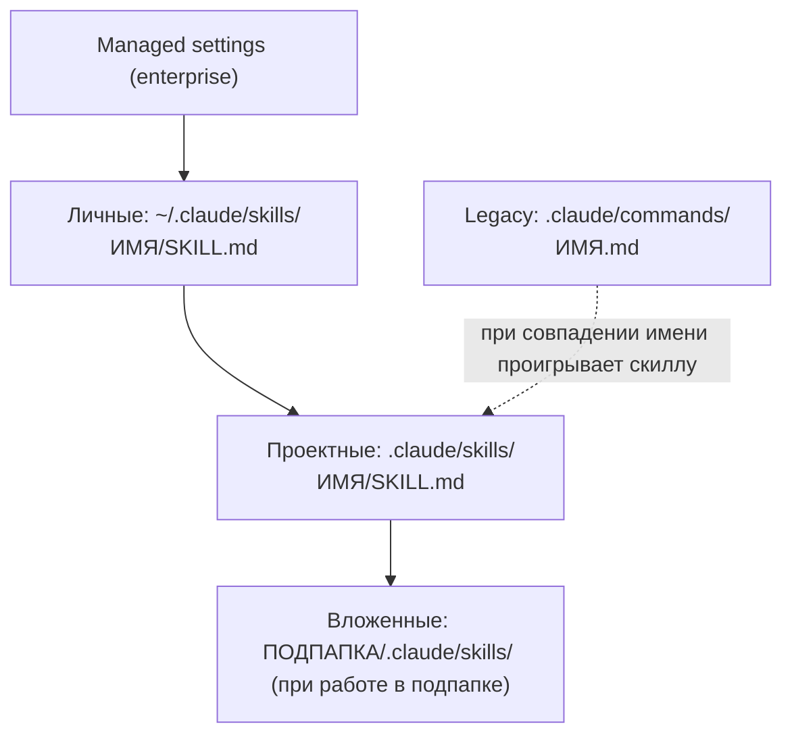

# Slash-команды Claude Code в anime-quiz-trainer

Справочник по командам, которые вы вводите с `/` в Claude Code: встроенные, свои (скиллы и legacy-команды) и команды этого проекта. Общая картина (агенты, хуки, права, MCP) — в [GUIDE.md](GUIDE.md). Короткая карта — в [README.md](README.md).

> **Статус сведений.** Список встроенных команд и правила скиллов взяты из официальной документации Claude Code (commands, skills, features-overview, hooks). Живой проверкой в этой сессии они не подтверждались: всё, что требует проверки в вашей версии Claude Code, отмечено как **(не проверено)**. Что именно есть в вашей версии, покажут `/help` и `/skills`. Файлы проекта (скиллы, агенты, хуки) проверены чтением репозитория.

## Содержание

1. [Как читать этот документ](#1-как-читать-этот-документ)
2. [Встроенные команды](#2-встроенные-команды)
   - [2.1 Сессия и контекст](#21-сессия-и-контекст)
   - [2.2 Конфигурация и модель](#22-конфигурация-и-модель)
   - [2.3 Расширения](#23-расширения)
   - [2.4 Ревью и git](#24-ревью-и-git)
   - [2.5 Диагностика и аккаунт](#25-диагностика-и-аккаунт)
   - [2.6 Удалённые и переименованные](#26-удалённые-и-переименованные)
3. [Свои команды](#3-свои-команды)
4. [Как создать свою команду — пошагово](#4-как-создать-свою-команду--пошагово)
5. [Команда, скилл, агент или хук — что выбрать](#5-команда-скилл-агент-или-хук--что-выбрать)
6. [Список команд этого проекта](#6-список-команд-этого-проекта)
7. [Предупреждение о конфликте имён](#7-предупреждение-о-конфликте-имён)

---

## 1. Как читать этот документ

- **Команда** — то, что вы печатаете после `/` в строке ввода: `/compact`, `/verify`.
- **Алиас** — второе имя той же команды (`/reset` = `/clear`). В таблицах алиасы указаны в скобках.
- **Аргументы** — текст после имени команды: `/pr 12` передаёт `12`.
- **Доступность** команд зависит от версии Claude Code, плана и платформы. Если команды нет в вашей сессии — это не ошибка документа: проверьте версию (`/upgrade`, `/status`).
- Колонка **«Осторожно»** — типичные ошибки и ограничения. Прочерк `—` значит, что особых ограничений в документации не найдено.

---

## 2. Встроенные команды

Встроенные команды поставляются вместе с Claude Code. Их не нужно создавать, но их поведение влияет на наш проект: например, `/compact` может «забыть» детали, которые вы ценили, а встроенный `/verify` конфликтует с нашим скиллом (см. [раздел 7](#7-предупреждение-о-конфликте-имён)).

### 2.1 Сессия и контекст

Контекст — это окно, в котором модель видит разговор, файлы и результаты команд. Его место ограничено, поэтому команды этой группы про «очистить», «сжать» и «разветвить».

| Команда (алиасы) | Что делает | Зачем и когда использовать | Пример | Осторожно |
|---|---|---|---|---|
| `/clear [имя]` (`/reset`, `/new`) | Начинает новый разговор с пустым контекстом. Память проекта (CLAUDE.md, rules) остаётся. | Смена задачи: обсуждение прошлой фичи не должно влиять на новую. | `/clear` перед работой над `/new-spec` для другой темы | Из старого разговора ничего не переносится автоматически. Важный итог заранее сохраните в файл (спеку, ADR) или через `/export`. |
| `/compact [инструкции]` | Сжимает историю в краткое резюме, освобождая место в контексте. | Сессия длинная, контекст заполнен, но задача продолжается. | `/compact keep the API decisions` | Правила, скиллы и файлы памяти после сжатия сохраняются. Всё, что не попало в резюме, теряется: передайте в инструкции то, что нельзя потерять. |
| `/resume [сессия]` (`/continue`) | Возвращает к прошлому разговору по ID, имени или через выбор из списка. | Вернуться к задаче на следующий день. | `/resume` → выбрать «daily-challenge» | Возвращается разговор, а не состояние репозитория. Откат кода — это `/rewind`. |
| `/rewind` (`/checkpoint`, `/undo`) | Откатывает разговор и/или код к контрольной точке. | Claude пошёл не туда и изменил не те файлы. | `/rewind` → точка до неудачной правки `backend-dev` | Перед откатом проверьте `git status`: откат касается того, что правил Claude, а ваши незакоммиченные правки могут пострадать (границы отката — **не проверено**). |
| `/branch [имя]` | Разветвляет разговор, чтобы попробовать другой подход. Исходный разговор доступен через `/resume`. | Сравнить два варианта решения, не теряя первый. | `/branch try-redis-cache` | Форк разговора не создаёт отдельную копию файлов. Для параллельной работы над кодом нужен отдельный worktree (см. раздел 9 GUIDE). |
| `/fork [промпт]` | Копирует разговор в новую фоновую сессию. Без agent view запускает форк-субагента. | Отдать самостоятельную подзадачу в фон, продолжая работать здесь. | `/fork проверь миграцию на потерю данных` | Поведение зависит от agent view (**не проверено** в вашей версии). Проверяйте список через `claude agents`. |
| `/subtask <задача>` | Форк-субагент с полным разговором. Результат возвращается в текущую сессию. | Тяжёлая побочная задача, для которой нужна вся история. | `/subtask проверь, что ApplyReview покрыт тестами` | Не доступна при выключенном agent view. Субагент несёт всю историю, поэтому для независимой проверки лучше обычный субагент (см. GUIDE, раздел 4). |
| `/background [промпт]` (`/bg`) | Переводит сессию в фоновый агент. Статус — `claude agents`. | Долгий прогон, пока вы занимаетесь другим. | `/bg запусти /verify и опиши падения` | Фоновые задачи легко забыть: проверяйте `claude agents`. |
| `/btw [вопрос]` | Побочный вопрос, который не попадает в историю разговора. | Быстро уточнить факт, не засоряя контекст задачи. | `/btw какая версия .NET в backend?` | Ответ тоже не остаётся в контексте задачи. Нужное перенесите вручную. |
| `/rename [имя]` | Даёт сессии имя. | Чтобы потом найти её в `/resume`. | `/rename daily-challenge-spec` | — |
| `/context [all]` | Цветная сетка с использованием контекста и подсказками. | Понять, что занимает место: история, файлы, инструменты MCP. | `/context` перед длинной задачей | Цифры — ориентир, а не точный бюджет. |
| `/export [имя файла]` | Экспортирует разговор в текстовый файл. | Сохранить итог обсуждения, например, для черновика ADR. | `/export adr-draft.txt` | Экспорт содержит ваши промпты и ответы. Не коммитьте его без просмотра: в переписке не должно быть секретов. |
| `/copy [N]` | Копирует последний (или N-й) ответ. | Вставить ответ в спеку или PR-описание. | `/copy 2` | — |
| `/exit` (`/quit`) | Завершает сессию. | — | `/exit` | — |

### 2.2 Конфигурация и модель

| Команда (алиасы) | Что делает | Зачем и когда использовать | Пример | Осторожно |
|---|---|---|---|---|
| `/init` | Генерирует стартовый `CLAUDE.md` для репозитория. Запускается один раз. `CLAUDE_CODE_NEW_INIT=1` включает интерактивный сценарий (скиллы, хуки, личная память). | Новый репозиторий без `CLAUDE.md`. | `/init` | В проекте `CLAUDE.md` уже есть (корень, `backend/CLAUDE.md`, `frontend/AGENTS.md`). Запуск `/init` не нужен; если всё же запустили, сравните результат с текущими файлами и не перезаписывайте их вслепую. |
| `/memory` | Редактирует файлы `CLAUDE.md`, включает/выключает авто-память, показывает записи авто-памяти. | Проверить, что Claude «запомнил», и удалить устаревшее. | `/memory` | Авто-память — заметки самого Claude, а не источник правды. Правила проекта держите в `CLAUDE.md` и `.claude/rules/`. |
| `/config [key=value]` (`/settings`) | Открывает UI настроек или задаёт значение. Режим редактора (Vim/Normal) настраивается здесь. | Изменить настройку без ручного редактирования JSON. | `/config model=sonnet` | Куда именно записывается значение — **не проверено**. Проектные правила, которые должны быть в git, меняйте в `.claude/settings.json` через PR. |
| `/model [модель]` | Меняет модель и сохраняет её как умолчание для новых сессий. В выборе клавиша `s` — только для текущей сессии. | Сложная архитектура — сильнее модель; рутина — быстрее. | `/model opus` | Агенты с явным `model:` в своём файле (у нас все на `sonnet`) от этой настройки не зависят. |
| `/effort [уровень\|auto\|status\|ultracode]` | Задаёт усилие рассуждения: от low до xhigh, max (только сессия), auto. | Сложный дизайн — выше; массовые правки — ниже. | `/effort high` | Больше усилия — дольше и дороже. Значение `ultracode` в документации не расшифровано — **TODO(вопрос)**. |
| `/fast [on\|off]` | Переключает быстрый режим. | Простые правки, где скорость важнее глубины. | `/fast on` | Подробности режима — **не проверено**. |
| `/plan [описание]` | Включает plan mode: только анализ и план, без правок файлов. | Крупная или неясная задача: сначала план, потом код. | `/plan вынести AuthService из Infrastructure в Application` | В plan mode файлы не меняются. Как выйти и подтвердить план — по подсказкам интерфейса (**не проверено**). |
| `/permissions` (`/allowed-tools`) | Управляет правилами allow/ask/deny и рабочими директориями. Показывает отказы авто-режима. | Понять, почему Claude снова спрашивает, или проверить правила. | `/permissions` | Разрешения, выданные в диалоге, могут действовать только на сессию (**не проверено**). Постоянные правила — в `.claude/settings.json` через PR. |
| `/add-dir <путь>` | Даёт доступ к другой директории в этой сессии. | Нужен код соседнего репозитория. | `/add-dir ../shared-contracts` | Большая часть `.claude/`-конфигурации из добавленных директорий **не загружается**: её агенты, скиллы и хуки там не работают. |
| `/cd <путь>` | Переносит сессию в другую рабочую директорию, сохраняя разговор. | Сменить корень работы, не начиная заново. | `/cd frontend` | Какие настройки подхватываются после смены — **не проверено**. Хуки проекта опираются на `$CLAUDE_PROJECT_DIR`, а не на текущую папку. |
| `/theme` | Выбор цветовой темы. | Удобство чтения. | `/theme` | — |
| `/output-style [стиль]` (v2.1.269+) | Выбирает стиль ответов. | Короче или подробнее отвечать. | `/output-style` | Стиль не передаётся субагентам. |
| `/statusline` | Настраивает статусную строку по текстовому описанию. | Видеть ветку, контекст и лимиты всё время. | `/statusline покажи ветку и заполненность контекста` | Личная настройка. Её не нужно коммитить. |
| `/keybindings` | Настраивает горячие клавиши. | Удобство. | `/keybindings` | — |
| `/terminal-setup` | Настраивает Shift+Enter для VS Code, Cursor, Alacritty, Zed и других терминалов. | Перенос строки в промпте без отправки. | `/terminal-setup` | Работает только для перечисленных терминалов. |
| `/color` | Цвет интерфейса сессии. | Отличать несколько параллельных сессий. | `/color` | Детали — **не проверено**. |
| `/autocompact [auto\|<токены>]` | Настраивает автоматическое сжатие контекста. | Когда сессия длинная и вы хотите контролировать момент сжатия. | `/autocompact auto` | Порог в токенах — **не проверено** по умолчанию. |
| `/sandbox` | Управляет песочницей выполнения команд. | Ограничить риск от Bash. | `/sandbox` | Точное поведение — **не проверено**. Наши ограничения Bash описаны в хуке `guard-bash`. |
| `/tui [default\|fullscreen]` | Переключает режим отображения. | Удобство чтения длинных ответов. | `/tui fullscreen` | — |

### 2.3 Расширения

Команды этой группы показывают и настраивают то, что мы построили в `.claude/`: агентов, хуки, MCP, плагины и скиллы.

| Команда (алиасы) | Что делает | Зачем и когда использовать | Пример | Осторожно |
|---|---|---|---|---|
| `/agents` | Печатает напоминание: попросите Claude управлять субагентами или редактировать `.claude/agents/` и `~/.claude/agents/`. До v2.1.197 открывал интерактивный менеджер. | Посмотреть, какие агенты есть. | `/agents` → «какие агенты доступны в проекте?» | Интерактивного менеджера в новых версиях нет. Старые инструкции «`/agents` → Create» не актуальны. |
| `/hooks` | Показывает настроенные хуки. | Проверить, что хук из `settings.json` зарегистрирован. | `/hooks` | Детали меню — **не проверено**. Хуки из файлов настроек применяются после принятия диалога доверия к рабочей папке. |
| `/mcp [reconnect\|enable\|disable [сервер\|all]]` | Показывает статус MCP-серверов, переподключает, включает и выключает их, проводит OAuth. | Сервер `context7` или `playwright` не отвечает. | `/mcp` → выбрать `playwright` → reconnect | Действие в сессии — **не проверено**, меняет ли оно `.mcp.json`. Сам `.mcp.json` в git правится через PR. |
| `/plugin [list\|install\|enable\|disable]` | Управляет плагинами. | Подключить набор агентов и скиллов из другого проекта. | `/plugin list` | Плагин — это код на вашей машине, как и MCP-сервер. Ставьте только проверенные. |
| `/reload-plugins [--force]` | Перечитывает плагины. | После правки плагина. | `/reload-plugins` | — |
| `/reload-skills` | Пересканирует папки скиллов. | Вы создали `.claude/skills/<имя>/`, а `/<имя>` не видно. | `/reload-skills` | Если не помогло, начните новую сессию (**не проверено** как общее правило). |
| `/skills` | Список скиллов с фильтром, сортировкой и стоимостью в токенах. | Проверить, что ваш скилл загрузился и не слишком «тяжёлый». | `/skills` | Список показывает скиллы всех уровней (личные, проектные, встроенные). При конфликте имён видно, какой загружен (**не проверено** в вашей версии). |
| `/skill-doctor` (v2.1.252+) | Показывает стоимость контекста каждого скилла. | Если описаний много, Claude хуже выбирает нужный скилл. | `/skill-doctor` | Список описаний для автовызова обрезается примерно на 1 536 символах (по документации). Длинные описания могут не попасть в список целиком. |
| `/loop [интервал] [промпт]` (`/proactive`) | Повторяет промпт, пока сессия открыта. | Ждать завершения деплоя, не нажимая вручную. | `/loop 5m проверь, завершился ли деплой` | Работает только при открытой сессии. Для задач «по расписанию» есть `/schedule`. |
| `/schedule [описание]` (`/routines`) | Создаёт и ведёт облачные запланированные задачи. | Регулярный отчёт, например, по устаревшим зависимостям. | `/schedule каждый понедельник проверь npm audit для frontend` | Облачная задача работает без вашей машины. Условия доступа и лимиты — **не проверено**. |
| `/goal [условие\|clear]` | Продолжает работу через ходы, пока условие не выполнено. | Довести до зелёного `npm run lint`. | `/goal npm run lint без ошибок во frontend` | Нечёткое условие — бесконечная работа и расход токенов. Пишите проверяемое условие и `/goal clear` для отмены. |
| `/list-agents` (`/peers`) | Выводит список агентов (пиров). | Посмотреть доступных исполнителей. | `/list-agents` | Что именно выводится — **не проверено**. |
| `/update-config [запрос]` | Скилл, который правит `settings.json` по описанию. | Добавить разрешение без ручной правки JSON. | `/update-config разреши Bash(npm run format:*)` | Меняет конфиг: читайте diff. Изменения `.claude/` в git проходят PR; владелец по `.github/CODEOWNERS` — `@KarpenkoIgor`. |
| `/claude-api` | Скилл со справкой по Claude API. | Писать код, который вызывает API Anthropic. | `/claude-api` | В нашем проекте не нужен: backend и frontend не вызывают Claude API. |

### 2.4 Ревью и git

| Команда (алиасы) | Что делает | Зачем и когда использовать | Пример | Осторожно |
|---|---|---|---|---|
| `/diff` | Показывает изменения рабочей копии, включая правки Claude. | Просмотреть всё, что уже изменено, перед коммитом. | `/diff` | Для сравнения ветки с `main` используйте `git diff main...HEAD` (или `/pr`). |
| `/code-review [уровень] [--fix] [--comment] [PR\|ветка\|путь]` (`/review`) | Скилл: ревью diff на ошибки корректности. Уровень `ultra` запускает облачное ревью. | Быстрая проверка до PR. | `/code-review feat/daily-challenge` | Алиас `/review` совпадает с **нашим** скиллом `review` — см. [раздел 7](#7-предупреждение-о-конфликте-имён). Флаг `--fix` правит код: сначала запустите без него. |
| `/security-review` | Ревью безопасности diff ветки относительно основной ветки `origin`. | Перед релизом или после изменения авторизации. | `/security-review` | Нужен remote `origin`. Наш агент `security-reviewer` — дополнение, а не замена. |
| `/simplify [цель]` | Ревью на переиспользование и эффективность, сразу применяет правки. Не ищет баги. | После рабочей фичи: убрать дубли и лишнее. | `/simplify backend/src/AnimeQuizTrainer.Application` | Меняет код. Порядок: `/verify` → `/simplify` → снова `/verify`. |
| `/batch <инструкция>` | Делит большое изменение на 5–30 частей; каждая — субагент в отдельном worktree, который открывает PR. | Массовое изменение, например, перевод всех контроллеров на ProblemDetails. | `/batch заменить все ошибки в контроллерах на ProblemDetails` | Создаёт много PR. Согласуйте с командой до запуска. Стоимость по токенам высокая (**не проверено**). |
| `/ultrareview [PR\|ветка]` | Глубокое многоагентное облачное ревью. Это `/code-review ultra`. Запускает пользователь, оплата отдельная. | Крупный PR перед релизом. | `/ultrareview 12` | Платно. Стоимость и лимиты — **TODO(вопрос)**. |
| `/verify` (встроенный) | Собирает и запускает приложение, чтобы подтвердить, что изменение работает. | Проверить визуальное изменение. | — | **В проекте есть свой скилл `/verify`** (сборка, тесты, lint). Он заменяет встроенный; см. [раздел 7](#7-предупреждение-о-конфликте-имён). |
| `/run` | Запускает приложение и управляет им. | Поднять сервер и клиент для ручной проверки. | `/run` | Как команда поведёт себя с `dotnet run` и `npm run dev` — **не проверено**. |
| `/run-skill-generator` | Создаёт проектный скилл `run-<имя>` с описанием запуска приложения. | Один раз описать запуск проекта, чтобы не объяснять его каждый раз. | `/run-skill-generator` | Куда пишется скилл и как его коммитить — **не проверено**. Коммитьте через PR. |

### 2.5 Диагностика и аккаунт

| Команда (алиасы) | Что делает | Зачем и когда использовать | Пример | Осторожно |
|---|---|---|---|---|
| `/help` | Справка по командам. | Забыли имя команды. | `/help` | Список зависит от версии и плана. |
| `/doctor [prompt-audit [путь]]` (`/checkup`) | Проверяет установку. `prompt-audit` (v2.1.283+) аудитирует промпты. | Команда «не находит» скилл или MCP работает странно. | `/doctor` | Что именно проверяет `prompt-audit` — **не проверено**. |
| `/debug [описание]` | Помогает разобрать проблему текущей сессии. | Хук не срабатывает, непонятная ошибка. | `/debug хук guard-bash не блокирует git push -f` | Вывод и содержимое — **не проверено**. Не отправляйте отчёт с секретами. |
| `/status` | Показывает версию, аккаунт, модель и настройки. | Проверить, какая модель активна. | `/status` | — |
| `/usage` (`/cost`, `/stats`) | Показывает расход и использование. | Следить за расходом на агентов, `/batch` и `/ultrareview`. | `/usage` | Точность цифр — **не проверено**. |
| `/login`, `/logout` | Вход и выход из аккаунта. | Смена аккаунта. | `/login` | Не вставляйте пароли и токены в чат; секреты через переменные окружения. |
| `/bug [отчёт]` (`/share`) и `/feedback` | Открывают один диалог отправки отчёта о баге Claude Code. | Нашли ошибку самого инструмента. | `/bug` | Перед отправкой проверьте, что попадает в отчёт (**не проверено**). |
| `/insights` | HTML-отчёт по последним сессиям. | Понять, где уходит время и контекст. | `/insights` | — |
| `/heapdump` (скрыта) | Снимает дамп памяти процесса. | Диагностика утечек, по запросу поддержки. | — | **Дамп содержит учётные данные.** Никогда не отправляйте его и не коммитьте. |
| `/ide` | Интеграция с IDE. | Работа из редактора. | `/ide` | Детали — **не проверено**. |
| `/install-github-app`, `/install-slack-app` | Установка приложений GitHub и Slack. | Интеграция с GitHub (CI-ревью запланировано, см. GUIDE). | `/install-github-app` | Меняет настройки внешнего сервиса. По нашим правилам внешние действия — только с явного разрешения владельца. |
| `/upgrade` | Обновляет Claude Code. | Нужна команда из новой версии. | `/upgrade` | Версия определяет доступность команд из этого документа. |
| `/restart` (`/update`) | Перезапускает или обновляет программу. | Применить изменения конфигурации. | `/restart` | Что именно перезапускается — **не проверено**. Надёжный способ применить изменения хуков и настроек — новая сессия. |

### 2.6 Удалённые и переименованные

Эти команды вы найдёте в старых инструкциях и статьях. В текущих версиях их нет.

| Команда | Статус | Что делать вместо этого |
|---|---|---|
| `/pr-comments` | Удалена в v2.1.91 | Попросите Claude напрямую: «прочитай комментарии к PR 12 и предложи правки». |
| `/vim` | Удалена в v2.1.92 | `/config` → режим редактора Vim/Normal. |
| `/ultraplan` | Удалена | Plan mode: `/plan <описание>`. |

---

## 3. Свои команды

Свои команды делятся на два вида: **скиллы** (новый механизм, рекомендуемый) и **legacy-команды** (`.claude/commands/*.md`, работают, но для новой работы не нужны). Оба вида вызываются одинаково — `/имя`.

### 3.1 Скилл или legacy-команда

| | Скилл | Legacy-команда |
|---|---|---|
| Файл | `<папка>/<имя>/SKILL.md` (папка с именем команды) | `<папка>/<имя>.md` (один файл) |
| Дополнительные файлы рядом | Да (см. 3.5) | Нет |
| Автовызов по описанию | Да | Да (**не проверено** как отдельная опция) |
| Рекомендация | Для всего нового | Не создавать новых; старые можно не трогать |

В документации сказано, что legacy-команды продолжают работать и сливаются со скиллами: `.claude/commands/deploy.md` и `.claude/skills/deploy/SKILL.md` оба дают `/deploy`. При совпадении имён **скилл побеждает**.

### 3.2 Где лежат и что важнее



Стрелки показывают порядок приоритета сверху вниз (по документации: enterprise > личные > проектные). Вложенные скиллы и legacy-файлы — отдельные случаи, см. таблицу ниже.

| Источник | Путь | Как вызывается | Заметка |
|---|---|---|---|
| Enterprise | задаётся managed settings | `/имя` | Высший приоритет |
| Личные | `~/.claude/skills/<имя>/SKILL.md` | `/имя` | Доступны во всех ваших проектах |
| Проектные | `.claude/skills/<имя>/SKILL.md` | `/имя` | Общие для команды через git. У нас — все 8 скиллов |
| Вложенные | `<подпапка>/.claude/skills/<имя>/SKILL.md` | `/подпапка:имя` (например, `/apps/web:deploy`) | Загружаются при работе в подпапке |
| Legacy (проектные) | `.claude/commands/<имя>.md` | `/имя` | Подпапки дают двоеточие: `commands/frontend/component.md` → `/frontend:component` |
| Плагины | `commands/<файл>.md` внутри плагина | `/<плагин>:<файл>` | Пространство имён плагина |
| Личные legacy | `~/.claude/commands/` | — | **(не проверено)** |

Правило приоритета: **скилл с тем же именем, что и legacy-файл, побеждает**. Пользовательский или проектный скилл с именем встроенной команды **заменяет** её, но **не заменяет её алиасы** (подробнее — [раздел 7](#7-предупреждение-о-конфликте-имён)).

### 3.3 Поля frontmatter

Frontmatter — блок между строками `---` в начале файла. Все поля необязательны. Рекомендуется заполнить `description`. **Неизвестные поля молча игнорируются**: опечатка в имени поля (например, `disable_model_invocation` с подчёркиванием) ничего не сломает, но и не сработает.

| Поле | Значение | Что даёт | Пример из нашего проекта или заметка |
|---|---|---|---|
| `name` | строка | Имя команды; по умолчанию — имя папки | `name: verify` |
| `description` | строка | Что делает скилл. По нему Claude решает, подходит ли скилл к запросу | Главное поле для автовызова |
| `when_to_use` | строка | Дополнительные условия для автовызова | **(не проверено)** как сочетается с `description` |
| `argument-hint` | строка | Подсказка в строке ввода | `argument-hint: "<что передавать>"` в `/new-spec` |
| `arguments` | список имён | Именованные позиционные аргументы для `$имя` | Синтаксис примера — **не проверено** |
| `disable-model-invocation` | `true` / `false` (умолч. `false`) | `true` — Claude не запускает скилл сам, только вы | `db-migration`, `pr` |
| `user-invocable` | `true` / `false` | `false` — скрыть из меню `/` | — |
| `allowed-tools` | список правил | Инструменты, которые можно использовать **без вопросов** на время хода | `Bash(dotnet build:*)` в `verify`. Не ограничивает остальные инструменты |
| `disallowed-tools` | список правил | Инструменты, запрещённые на время хода | Не используется |
| `model` | имя модели | Модель для этого скилла | Не используется |
| `effort` | уровень | Усилие рассуждения для скилла | Не используется |
| `context` | `fork` | Выполнить скилл в форк-субагенте, а не в текущем разговоре | Не используется |
| `agent` | имя агента | Какой агент выполняет скилл (в связке с `context`) | **(не проверено)** детали |
| `background` | `true` / `false` | Запуск в фоне | **(не проверено)** |
| `hooks` | блок hooks | Хуки, действующие только пока работает скилл | Не используется |
| `paths` | маски путей | Скилл автоматически активен только для подходящих файлов | Не используется |
| `shell` | `bash` / `powershell` | Оболочка для `!`-инъекций (раздел 3.7) | Не используется: мы на Windows, но инъекций нет |
| `metadata`, `license`, `compatibility` | произвольные | Справочные данные | **(не проверено)** влияние |

### 3.4 Аргументы

| Запись в скилле | Что подставляется | Пример вызова `/pr-summary 456` |
|---|---|---|
| `$ARGUMENTS` | вся строка аргументов целиком | `PR $ARGUMENTS` → `PR 456` |
| `$ARGUMENTS[N]` | N-й аргумент, нумерация с 0 | `$ARGUMENTS[0]` → `456` |
| `$0`, `$1`… | то же, короткой записью | `$0` → `456` |
| `$имя` | аргумент с этим именем из поля `arguments` | **(синтаксис — не проверено)** |
| `${CLAUDE_SESSION_ID}` | ID сессии | — |
| `${CLAUDE_EFFORT}` | текущее усилие | — |
| `${CLAUDE_SKILL_DIR}` | папка самого скилла | `${CLAUDE_SKILL_DIR}/scripts/check.mjs` |
| `${CLAUDE_PROJECT_DIR}` | корень проекта | — |

**Кавычки.** Аргументы в кавычках остаются одним значением: `/my-skill "hello world" second` даёт `$0 = hello world`, `$1 = second`.

**Если плейсхолдера нет.** Если в теле скилла нет ни одного `$`-плейсхолдера, а аргументы переданы, Claude Code добавит их в конец как `ARGUMENTS: <ввод>`. Поэтому `/verify quick` в нашем `verify` не ломается, но и не меняет поведение.

**Экранирование.** Чтобы в тексте остался настоящий знак доллара, пишите `\$`.

Примеры из проекта: `/pr 12` (в `pr` — `$ARGUMENTS` как номер issue), `/new-spec ежедневный челлендж` (в `new-spec` — тема), `/db-migration AddUserRating` (в `db-migration` — имя миграции).

### 3.5 Вспомогательные файлы

Папка скилла может содержать не только `SKILL.md`:

```
.claude/skills/my-skill/
├── SKILL.md            # основная инструкция, держите до ~500 строк
├── reference.md        # справка: читается, только если понадобилась
├── examples.md         # примеры
└── scripts/
    └── check.mjs       # запускается через ${CLAUDE_SKILL_DIR}/scripts/check.mjs
```

Дополнительные файлы загружаются **по необходимости**, а не целиком. У всех наших скиллов пока только `SKILL.md` (проверено по репозиторию).

### 3.6 Автовызов

Claude сопоставляет запрос с `description` (и `when_to_use`) всех доступных скиллов. Список описаний в контексте обрезается примерно на 1 536 символах, поэтому длинные описания могут не попасть в список целиком (`/skill-doctor` покажет стоимость).

Тело скилла загружается только при вызове. После сжатия контекста (`/compact`) каждый вызванный скилл сохраняет первые 5 000 токенов в общем бюджете 25 000 токенов.

**Управление автовызовом:**
- `disable-model-invocation: true` — только ручной вызов. Для скиллов с побочными эффектами (запись в БД, push, PR) это обязательно.
- `user-invocable: false` — скилл доступен Claude, но не виден в меню `/`.

### 3.7 Инъекция `` !`команда` ``

Строка вида `` !`git log main..HEAD --oneline` `` выполняется **до** отправки скилла модели, а результат подставляется на её место. Это удобно, чтобы дать Claude актуальные данные.

- Команда проверяется правилами разрешений (`allow`/`deny`) так же, как обычный Bash.
- Ненулевой код выхода прерывает скилл (исключение — `grep` с кодом 1).
- Отключается настройкой `"disableSkillShellExecution": true` для нестандартных скиллов.

В наших восьми скиллах инъекций **нет** (проверено по файлам). Пример с инъекцией — в [разделе 4.2](#42-второй-пример-changelog-текстовый-образец).

### 3.8 Команды плагинов и MCP-промпты

- **Плагин:** файл `commands/<файл>.md` внутри плагина становится командой `/<плагин>:<файл>`. Плагины пока не используются в проекте.
- **MCP-промпты:** MCP-сервер может предлагать промпты. Они появляются как `/<сервер>:<промпт> (MCP)` или `/mcp__<сервер>__<промпт>`. Какие промпты предлагают `context7`, `playwright` и `github` — **не проверено**; посмотрите в `/help` или `/mcp`.

---

## 4. Как создать свою команду — пошагово

### 4.1 Разбор `.claude/skills/verify/SKILL.md` построчно

Это реальный скилл проекта. Ниже — файл целиком по частям с пояснением каждой строки. Текст самого файла не меняется.

#### Блок frontmatter (строки 1–5)

```markdown
1  ---
2  name: verify
3  description: Full project check before commit/PR — backend build and tests, frontend typecheck, lint and build. Run when you need to confirm everything is green, or before creating a PR.
4  allowed-tools: Bash(dotnet build:*), Bash(dotnet test:*), Bash(npm run:*), Bash(git status:*)
5  ---
```

- **Строка 1 и 5 (`---`).** Границы frontmatter. Без них Claude увидит файл как обычный текст и не распознает команду.
- **Строка 2 (`name: verify`).** Имя команды: будет `/verify`. Если бы поля не было, именем стало бы имя папки `verify`. Здесь поле повторяет папку — это нормально и делает имя явным.
- **Строка 3 (`description`).** Самое важное поле. Во-первых, это подпись в меню `/`. Во-вторых, по нему Claude решает, что скилл подходит, если вы просто написали «проверь всё перед PR». Фраза «before creating a PR» намеренно привязывает скилл к этому моменту. Описание короткое, но содержит и «что», и «когда».
- **Строка 4 (`allowed-tools`).** Список инструментов, которые можно вызывать **без подтверждения** на время выполнения команды. Здесь разрешены `dotnet build`, `dotnet test`, `npm run` и `git status` — ровно то, что нужно шагам. **Важно:** это не ограничение. Если Claude понадобится другая команда, он всё равно спросит вас.
  - Замечание: `Bash(npm run:*)` разрешает **любой** скрипт `npm run`, включая `npm run dev` (долгий процесс) и `npm run format` (правит файлы через prettier). Для строгости можно сузить до `Bash(npm run typecheck)`, `Bash(npm run lint)`, `Bash(npm run build)`. Это предложение, файл не менялся.
- Поля `argument-hint`, `disable-model-invocation`, `model` и другие **не указаны**. Значит, в строке ввода не будет подсказки об аргументах, а Claude может вызвать скилл сам (по `description`), а не только вы.

#### Тело скилла (строки 7–17)

```markdown
7  # /verify — project check
9  Run in order, stopping at the first failure, and report each step's result:
11 1. **Backend build** (warnings are errors): `dotnet build backend -nologo -v q`
12 2. **Backend tests** (if `backend/tests` exists): `dotnet test backend --no-build -nologo`
13 3. **Frontend typecheck** (from `frontend/`): `npm run typecheck`
14 4. **Frontend lint** (from `frontend/`): `npm run lint` — errors are not allowed; warnings (currently ~155) must not grow.
15 5. **Frontend build** (only if a full check was requested): `npm run build`
17 Finish with a table `step | result | time`. If something failed: show the key error lines, name the cause and propose a fix; **never claim "green" without running**. If there are no tests yet, say so. Write the report to the user in Russian.
```

- **Строка 7 (`# /verify — project check`).** Заголовок для людей. Claude его читает как текст, никакой специальной роли он не несёт.
- **Строка 9 (порядок).** «Run in order, stopping at the first failure» — задаёт последовательность и остановку при ошибке. Без этого Claude мог бы продолжить после падения сборки и выдать смешанный отчёт.
- **Строка 11 (сборка бэкенда).** Точная команда. Фраза «warnings are errors» совпадает с реальностью: в `backend/Directory.Build.props` стоит `TreatWarningsAsErrors` (проверено). Поэтому предупреждение = красная сборка.
- **Строка 12 (тесты).** Команда выполняется **только если** есть `backend/tests`. Такой папки в репозитории сейчас нет (проверено), поэтому шаг будет пропущен, а отчёт должен сказать «тестов пока нет». Это то, что предусматривает строка 17.
- **Строка 13 (typecheck).** Соответствует скрипту `"typecheck": "tsc --noEmit"` в `frontend/package.json`.
- **Строка 14 (lint).** Два правила: ошибки недопустимы, предупреждения не должны расти. Число «~155» — **не проверено** (мы его не запускали). Правило «не должны расти» требует сравнения с прежним значением, которое Claude сам не знает. Это **TODO(вопрос)**: где фиксируется базовое число предупреждений.
- **Строка 15 (build).** Выполняется «только если запрошена полная проверка». Что такое «полная» — не определено в файле. **TODO(вопрос)**: либо задать критерий (например, аргумент `full`), либо убрать условие.
- **Строка 17 (итог).** Три правила: формат отчёта (таблица), запрет говорить «зелёно» без запуска (против выдуманных результатов), язык отчёта — русский.

#### Что здесь можно улучшить

1. Сузить `Bash(npm run:*)` (см. строку 4).
2. Ввести аргумент для режима «полная проверка» и описать его в `argument-hint` — тогда строка 15 станет однозначной.
3. Убрать из строки 14 число предупреждений или хранить его в одном месте.

Это предложения. Файлы в `.claude/` не менялись: правка конфигурации идёт через PR с владельцем по `CODEOWNERS`.

### 4.2 Второй пример: `/changelog` (текстовый образец)

Ниже — образец нового скилла для этого проекта. **Он не создан** в `.claude/`; это текст для обсуждения. Если команда решит его завести, положите файл в `.claude/skills/changelog/SKILL.md`, затем выполните `/reload-skills` и проверьте `/skills`.

```markdown
---
name: changelog
description: Добавляет записи в CHANGELOG.md по Keep a Changelog из Conventional Commits текущей ветки. Используй, когда просят обновить CHANGELOG или перед PR с изменениями для пользователя.
argument-hint: "[версия или Unreleased]"
allowed-tools: Bash(git log:*), Bash(git diff:*)
---

# /changelog — запись в CHANGELOG

Раздел: **$ARGUMENTS** (если пусто — `Unreleased`).

Коммиты ветки относительно main:
!`git log main..HEAD --oneline`

1. Разбери коммиты по типам Conventional Commits из `.claude/rules/git-workflow.md`: `feat` → Added, `fix` → Fixed, `refactor` и `perf` → Changed. Типы `chore`, `docs`, `test`, `ci`, `build` пропусти, если они не меняют поведение для пользователя.
2. Открой `CHANGELOG.md`. Если файла нет, создай его по формату Keep a Changelog. Добавь пункты в раздел `## [Раздел]`.
3. Покажи diff и дождись подтверждения. Отчёт — на русском.
```

Разбор:

- `name` и `description` — имя `/changelog` и условие автовызова («обновить CHANGELOG», «перед PR»).
- `argument-hint` — подсказка в строке ввода: `/changelog 1.2.0` или `/changelog` без аргумента.
- `allowed-tools` — чтение истории git без подтверждения. Оба правила уже есть в `settings.json` (`Bash(git log:*)`, `Bash(git diff:*)`), поэтому подтверждения не потребуется.
- `$ARGUMENTS` в заголовке раздела. Пустой аргумент даёт `Unreleased` — это проверка «что если аргумента нет» словами шага.
- Строка `!`git log main..HEAD --oneline`` — инъекция (раздел 3.7): список коммитов подставится до того, как Claude начнёт работать.
- Шаг 1 привязан к типам из `.claude/rules/git-workflow.md`. Не придумывайте свои: иначе правило и скилл разойдутся.
- Шаг 3 оставляет решение за человеком: скилл не коммитит и не пушит.

Проверка после создания: `/reload-skills`, затем `/skills` (скилл виден), затем `/changelog` (отработал). **(Поведение `/reload-skills` в вашей версии — не проверено.)**

### 4.3 Чек-лист новой команды

1. Создайте папку `.claude/skills/<имя>/` и файл `SKILL.md`.
2. Напишите `description` так, чтобы по нему было ясно «что» и «когда».
3. Укажите в `allowed-tools` только то, что нужно шагам. Широкие маски вроде `Bash(npm run:*)` — только если понимаете, что они разрешают.
4. Если команда меняет что-то необратимое или внешнее (БД, push, PR, внешние сервисы), поставьте `disable-model-invocation: true`.
5. Если нужны данные из аргумента, используйте `$ARGUMENTS` или `$0`. Если аргумент обязателен, укажите его в `argument-hint` и напишите в теле, что делать при пустом вводе.
6. Проверьте `/skills` и один вызов вручную.
7. Отправьте изменение через PR. Владелец `.claude/` указан в `.github/CODEOWNERS`.

---

## 5. Команда, скилл, агент или хук — что выбрать

**Правило выбора одной фразой.** Если это должно случиться **всегда, без исключений**, — делайте хуком. Если это **повторяемая процедура**, которую запускает человек, — скилл. Если нужна **отдельная роль с отдельным контекстом** — агент. Если это **знание**, которое Claude должен учитывать, — `CLAUDE.md` или rules. Если нужен **внешний инструмент или данные** — MCP. Разовая просьба — обычный промпт.

Контраст из документации: скилл и команда выполняются Claude по инструкции (недетерминированно), хук срабатывает сам при событии (детерминированно).

| Ситуация в проекте | Что выбрать | Почему |
|---|---|---|
| Запретить `git push --force` и push в `main` | **Хук** `guard-bash` (`PreToolUse`, deny) плюс правило `deny` в `settings.json` | Просьба в `CLAUDE.md` может быть нарушена; хук нет |
| Перед PR каждый раз проверить сборку и тесты | **Скилл** `/verify` (вызов руками) | Повторяемая процедура с шагами и отчётом |
| Перед завершением ответа не оставить сломанную сборку | **Хук** `stop-check` (`Stop`) | Должно срабатывать на каждом ответе |
| Проверить diff двумя независимыми взглядами (качество и безопасность) | **Агенты** `code-reviewer` и `security-reviewer`, запущенные параллельно через скилл `/review` | Независимость: ревьюер не должен быть автором; агенты работают в отдельном контексте |
| Разобраться в незнакомом модуле, не засоряя основной разговор | **Субагент** (например, `architect` с задачей «опиши слои») | Шумное чтение остаётся в его контексте; вам возвращается отчёт |
| Правило «контроллер не обращается к `DbContext`» | **Rules** `backend-clean-arch.md` (подгружаются по путям) плюс проверка `code-reviewer` | Техническую блокировку на такое правило хук не даёт (проверка по содержимому кода сложна); правило должно быть в памяти |
| Не давать писать в `.env` и миграции | **Хук** `guard-files` и `deny` в `settings.json` | Гарантия, а не просьба |
| Актуальная документация Next.js или EF Core | **MCP** `context7` (фраза «use context7») | Внешние данные, которых нет в знаниях модели |
| Создать спеку из идеи | **Скилл** `/new-spec` | Процедура с шаблоном и сохранением файла |
| Проверить работу UI в браузере | **MCP** `playwright` (пока без e2e-сценариев) | Внешний инструмент; сам по себе не процедура |
| Короткий уточняющий вопрос, который не должен попасть в историю | **`/btw`** | Встроенная команда, ответ не засоряет контекст |

---

## 6. Список команд этого проекта

Все восемь скиллов проекта лежат в `.claude/skills/<имя>/SKILL.md`. Ниже — что делает каждый, когда вызывать и пример. Прочитано по файлам; текст команд не меняется.

| Команда | Аргумент | Автовызов | Что делает |
|---|---|---|---|
| `/new-feature` | описание фичи или ссылка на спеку/issue | да (см. заметку) | Ведёт фичу от идеи до PR по этапам, с паузами на подтверждение |
| `/new-spec` | короткое описание темы | да | Создаёт спеку в `docs/specs/` по шаблону |
| `/new-adr` | тема решения | да | Создаёт ADR в `docs/adr/` с номером |
| `/db-migration` | имя миграции | **нет** | Создаёт миграцию EF, проверяет её, описывает откат. Не применяет |
| `/verify` | нет | да | Сборка, тесты, typecheck, lint |
| `/review` | ветка, коммит или путь (по умолчанию — текущий diff) | да | Два агента ревьюят параллельно, отчёт по severity |
| `/sync-docs` | область: `backend`, `frontend`, `api`, `all` | да | Сверяет документацию с кодом и предлагает правки |
| `/pr` | номер issue (необязательно) | **нет** | Готовит PR, после подтверждения пушит и создаёт через `gh` |

### 6.1 `/new-feature`

- **Что:** сквозной сценарий. Ветка `feat/<тема>` → спека → план (`architect`) → тесты (`qa-engineer`) → код (`backend-dev`/`frontend-dev`) → `/verify` → `/review` → `/sync-docs` → коммиты и `/pr`. Этапы с паузой отмечены в тексте скилла (в файле это символ паузы).
- **Когда:** нетривиальная фича, где нужны спека и план.
- **Пример:** `/new-feature рейтинг для дуэлей 1v1 с сезонами`
- **Заметка:** поле `disable-model-invocation` не задано, а `description` говорит «use for any non-trivial feature». Значит, Claude может запустить весь сценарий сам, без вашего вызова. Паузы остановят работу, но ветка и файлы могут появиться раньше, чем вы этого ждали. **Рекомендация:** поставить `disable-model-invocation: true`. Решение за командой.

### 6.2 `/new-spec`

- **Что:** спрашивает до трёх уточнений, если тема неясна. Делегирует `product-analyst` (для механик — `game-designer`, для контента — `anime-content-curator`, для викторин — `quiz-designer`). Сохраняет `docs/specs/<kebab-name>.md` со статусом `draft` по `docs/specs/_template.md`.
- **Когда:** идея готова, но нет требований.
- **Пример:** `/new-spec ежедневный челлендж: один трек в день, общий для всех`

### 6.3 `/new-adr`

- **Что:** берёт следующий номер из `docs/adr/NNNN-*.md` (сейчас есть только `0000-template.md`, значит следующий — `0001`), сравнивает варианты через `architect`, создаёт файл со статусом `proposed` (или `accepted`, если решение согласовано).
- **Когда:** принято значимое техническое решение: слои, хранилище, протокол, библиотека, хостинг.
- **Пример:** `/new-adr выбор транспорта реального времени для дуэлей`

### 6.4 `/db-migration`

- **Что:** проверяет, что сущности и конфигурации EF готовы и `dotnet build` проходит. Генерирует миграцию командой `dotnet ef migrations add` с нужными путями. Читает результат (нет ли потери данных, NOT NULL без дефолта, drop вместо rename). Описывает откат. **Не выполняет** `dotnet ef database update`.
- **Когда:** изменилась схема БД.
- **Пример:** `/db-migration AddUserRating`
- **Защита:** хук `guard-files` запрещает ручную правку миграций; хук `guard-bash` спрашивает перед `database update`.

### 6.5 `/pr`

- **Что:** проверяет ветку (не `main`), вызывает `/verify`, собирает `git log main..HEAD` и diff, пишет заголовок в Conventional Commits и описание. Показывает вам и ждёт подтверждения. После него: `git push -u origin <ветка>` и `gh pr create`.
- **Когда:** работа в ветке закончена.
- **Пример:** `/pr 12`
- **Заметки:** `gh` в скилле не указан в `allowed-tools`, поэтому Claude спросит разрешение (это нормально). Установлен ли `gh` на вашей машине, не проверено; если нет, скилл даёт готовый текст для вставки вручную. Хук `guard-bash` блокирует push, в имени которого есть `main` или `master` как отдельное слово (см. GUIDE, раздел 3, ложные срабатывания).

### 6.6 `/review`

- **Что:** определяет область (незакоммиченное и коммиты относительно `main`), **параллельно** запускает `code-reviewer` и `security-reviewer`, объединяет результаты по severity (blocker → major → minor → nit). Сам правки не вносит.
- **Когда:** перед PR или после крупного изменения.
- **Пример:** `/review feat/daily-challenge` или `/review backend/src/AnimeQuizTrainer.Application`
- **Внимание:** имя совпадает с алиасом встроенной команды — см. [раздел 7](#7-предупреждение-о-конфликте-имён).

### 6.7 `/sync-docs`

- **Что:** сверяет `docs/`, `README.md`, `CLAUDE.md`, `backend/CLAUDE.md`, `frontend/AGENTS.md` с реальным кодом. Список расхождений «документ → что устарело → что верно (путь)». Правки делегирует `tech-writer` (спеки — `product-analyst`). Новое архитектурное решение без ADR предлагает оформить через `/new-adr`.
- **Когда:** после крупных изменений или перед релизом.
- **Пример:** `/sync-docs backend`
- **Заметка:** скилл упоминает `docs/README.md` («если существует»). Сейчас файла нет (проверено).

### 6.8 `/verify`

- **Что:** см. [раздел 4.1](#41-разбор-claudeskillsverifyskillmd-построчно). Сборка бэкенда (warnings = errors), тесты (если есть `backend/tests`), `npm run typecheck`, `npm run lint`, при полном запросе — `npm run build`.
- **Когда:** перед коммитом, PR, после любой правки кода.
- **Пример:** `/verify`
- **Внимание:** имя совпадает со встроенным `/verify` — см. [раздел 7](#7-предупреждение-о-конфликте-имён).

---

## 7. Предупреждение о конфликте имён

В проекте два скилла называются так же, как встроенные команды Claude Code: `verify` и `review`. Ниже — что говорит документация и что остаётся неизвестным.

### 7.1 Что сказано в документации

- Пользовательский или проектный скилл с именем встроенной команды **заменяет** эту команду.
- Замена **не распространяется на алиасы** команды. Пример из документации: скилл `code-review` заменяет `/code-review`, но **не** алиас `/review`.
- Что происходит при совпадении имени скилла с **алиасом** (как у нас с `review`), в документации явно не описано. См. TODO ниже.

### 7.2 Что это значит для нас

| Имя у нас | Встроенная команда | Что по документации | Статус |
|---|---|---|---|
| `verify` (`.claude/skills/verify/`) | `/verify` (встроенный скилл: сборка и запуск приложения для проверки изменения) | Наш скилл должен заменить встроенный `/verify` | **Вероятно** так, но **TODO(вопрос):** подтвердить в живой сессии: `/help` и `/skills` должны показать один `/verify` из проекта |
| `review` (`.claude/skills/review/`) | алиас `/review` команды `/code-review` | Документация описывает замену **команды**, но не отвечает, что победит при совпадении с **алиасом** | **TODO(вопрос):** при вызове `/review` в сессии проверить, какой скилл запускается. Признак нашего: команда пишет «Review target: …» и запускает два агента параллельно. Признак встроенного: вывод `/code-review` |

### 7.3 Почему это важно

- Если `/review` откроет встроенный `/code-review`, наши шаги (агенты `code-reviewer` и `security-reviewer` параллельно) не выполнятся, а `new-feature` и `pr` ожидают именно наш результат.
- Если `/verify` откроет встроенный скилл, сборка и тесты проекта не запустятся, и `/pr` и `/new-feature` будут проверять не то.
- Claude может выбрать скилл и по описанию (автовызов), даже когда вы не печатали команду.

### 7.4 Что предлагается (решение за командой)

Переименовать наши скиллы, чтобы не зависеть от порядка приоритета:

| Сейчас | Предложение | Почему это имя |
|---|---|---|
| `/verify` | `/check` | Коротко: проверка проекта. В списке встроенных команд из этого документа такого имени нет **(проверено по нашему списку; полный список вашей версии — не проверено)** |
| `/review` | `/pr-review` | Понятно, что это ревью изменений перед PR; в списке встроенных нет |

Что придётся изменить при переименовании (это правки в `.claude/` и `docs/`, их делает владелец через PR):

- Папки и имена: `.claude/skills/verify/` и `.claude/skills/review/`.
- Упоминания `/verify`: `.claude/skills/pr/SKILL.md` (строки 3 и 13), `.claude/skills/new-feature/SKILL.md` (строка 18), `docs/claude/README.md`, `docs/claude/GUIDE.md`, этот файл.
- Упоминания `/review`: `.claude/skills/new-feature/SKILL.md` (строка 19), `docs/claude/README.md`, `docs/claude/GUIDE.md`, этот файл.
- Заголовки внутри самих файлов скиллов (`# /verify — project check`, `# /review — change review`).

Пока решение не принято, документация использует текущие имена и отмечает конфликт.
