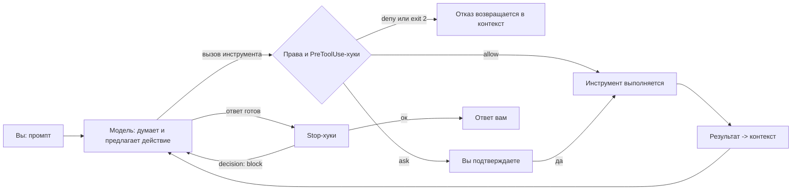
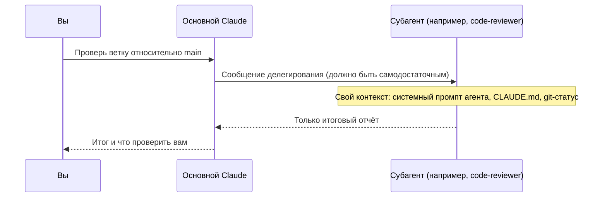
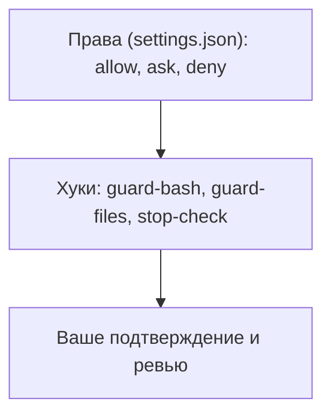

# Руководство по Claude Code на примере anime-quiz-trainer

Цель — понимать, **как устроен Claude Code, что мы настроили и почему**, и уметь так же организовать любой следующий проект.

Документ написан по реальной конфигурации репозитория: все пути, команды и значения сверены с файлами. Сведения о самом Claude Code взяты из его официальной документации и **в живой сессии не проверялись**. Там, где это важно, стоит пометка **(не проверено)** или **TODO(вопрос)**. Короткая карта — в [README.md](README.md). Справочник по командам с `/` — в [COMMANDS.md](COMMANDS.md).

> **Как проверялась конфигурация.** Прочитаны: `.claude/settings.json`, `.claude/settings.local.json`, `.claude/hooks/*.mjs`, `.claude/agents/*.md` (все 13), `.claude/skills/*/SKILL.md` (все 8), `.claude/rules/*.md` (все 5), `.mcp.json`, корневой `CLAUDE.md`, `backend/CLAUDE.md`, `frontend/CLAUDE.md`, `frontend/AGENTS.md`, `.github/CODEOWNERS`, `.gitignore`, `.editorconfig`. Расхождения между документами и файлами перечислены в конце.

## Содержание

0. [Глоссарий](#0-глоссарий)
1. [Ментальная модель](#1-ментальная-модель)
2. [CLAUDE.md и rules](#2-claudemd-и-rules)
3. [Hooks: автоматические проверки](#3-hooks-автоматические-проверки)
4. [Как агент получает контекст](#4-как-агент-получает-контекст)
5. [Агенты](#5-агенты)
6. [Skills и slash-команды](#6-skills-и-slash-команды)
7. [Права и безопасность](#7-права-и-безопасность)
8. [MCP](#8-mcp)
9. [Другие возможности](#9-другие-возможности)
10. [Сценарии end-to-end](#10-сценарии-end-to-end)
11. [Как писать эффективные промпты](#11-как-писать-эффективные-промпты)
12. [Шпаргалка и как расширять конфигурацию](#12-шпаргалка-и-как-расширять-конфигурацию)
13. [Известные расхождения на дату написания](#13-известные-расхождения-на-дату-написания)

---

## 0. Глоссарий

Сначала — слова простым языком. Каждое понятие дано с бытовой аналогией; технические детали — в следующих разделах.

| Термин | Простыми словами | Аналогия | Где это у нас |
|---|---|---|---|
| **Claude Code** | Программа в терминале, в которой вы работаете с Claude над кодом | Рабочее место с ассистентом и набором инструментов | Вы запускаете `claude` в папке репозитория |
| **Модель** | Сам «мозг»: читает, думает, предлагает действия | Опытный повар, который решает, что делать дальше | Sonnet, Opus и др. Выбор — `/model` |
| **Харнесс** | Программа вокруг модели: выполняет действия, спрашивает разрешения, запускает хуки | Кухня с плитой, ножами и правилами безопасности. Повар не может сам открыть газ мимо правил | Всё, что делает сам Claude Code, а не модель |
| **Контекст** | Всё, что модель видит прямо сейчас: разговор, прочитанные файлы, результаты команд | Рабочий стол. Место ограничено: что убрали со стола, того повар не видит | Растёт в ходе сессии; `/context` показывает, что занимает место |
| **Токен** | Кусочек текста, из которого считаются объём контекста и стоимость | Мерная единица, как грамм для продуктов | Лимиты и расход — `/usage` |
| **Сессия** | Один запуск `claude` от старта до выхода, со своим контекстом | Одна смена на работе | `/clear` начинает новую внутри того же запуска |
| **Промпт** | Текст, который вы пишете Claude | Задание на листке | Раздел 11 |
| **Инструмент (tool)** | Конкретное действие, которое может выполнить модель: `Read`, `Edit`, `Bash`, `Grep`, `Write`, `WebFetch` | Отвёртка, дрель, мерная лента | Перечислены в `tools:` агента; без `tools:` доступны все |
| **Права (permissions)** | Правила: что можно без вопросов, что спрашивать, что запрещено | Охранник с журналом на входе | `.claude/settings.json`, раздел `permissions` |
| **Хук (hook)** | Скрипт, который харнесс запускает сам при наступлении события | Датчик пожарной сигнализации: срабатывает сам, не спрашивая повара | `.claude/hooks/*.mjs`, регистрация в `settings.json` |
| **Событие (event)** | Момент, на который может сработать хук: старт сессии, перед вызовом инструмента, конец ответа | Сигнал «открылась дверь», «начался обед» | Наши: `SessionStart`, `PreToolUse`, `Stop` |
| **Matcher** | Фильтр хука: на какой инструмент реагировать | Датчик только на дверь кухни, а не на весь этаж | `"matcher": "Bash"` в `settings.json` |
| **Exit code** | Код возврата скрипта. `0` — всё хорошо, `2` — стоп с объяснением | Табличка «проход открыт» или «стоп, вот почему» | Раздел 3.4 |
| **Субагент (agent)** | Исполнитель с собственным контекстом, инструментами и моделью. Возвращает только итоговый отчёт | Подрядчик с отдельным кабинетом: получил письмо с заданием, сделал, прислал акт | `.claude/agents/*.md`, 13 штук |
| **Делегирование** | Передача задачи субагенту | Отправка задания подрядчику | Сообщение, которое пишет основной Claude |
| **Fork (форк)** | Копия разговора, которая продолжается отдельно. Субагент-форк видит всю переписку | Подрядчику дали прочитать всю переписку с заказчиком | `/subtask`, `/fork`, `context: fork` |
| **Скилл (skill)** | Папка с инструкцией «как делать процедуру». Вызывается `/имя` или автоматически | Чек-лист в папке: «как проверить проект перед PR» | `.claude/skills/<имя>/SKILL.md`, 8 штук |
| **Slash-команда** | Имя, которое вы печатаете после `/`. Может быть встроенной, скиллом или legacy-файлом | Кнопка с подписью на пульте | `/verify`, `/compact`, `/pr 12` |
| **Legacy-команда** | Старый формат своей команды: один файл в `.claude/commands/` | Старая кнопка, которую ещё не сняли | Не используется у нас |
| **MCP** | Стандартный разъём, через который Claude подключает внешние инструменты и данные | Розетка: в неё включаются внешние приборы | `.mcp.json`: context7, playwright, github |
| **MCP-сервер** | Внешняя программа, которая предоставляет инструменты по MCP | Прибор, включённый в розетку | Запускается на вашей машине |
| **CLAUDE.md** | Памятка, которую Claude читает в начале работы | Памятка на входе в офис: как здесь работают | Корень, `backend/CLAUDE.md`, `frontend/CLAUDE.md` |
| **Rules** | Правила, которые подгружаются только для нужных путей файлов | Вкладки памятки, которые открываются только для нужного участка | `.claude/rules/*.md` |
| **Plan mode** | Режим, в котором Claude только читает и составляет план, ничего не меняя | Чертёж без стройки | `/plan <описание>` |
| **Auto memory (авто-память)** | Заметки, которые Claude сохраняет сам для будущих сессий | Блокнот ассистента | `/memory` (**детали — не проверено**) |
| **Worktree** | Отдельная рабочая копия того же репозитория, для параллельной работы | Вторая рабочая поверхность, чтобы не мешать соседу | Поле `isolation: worktree`, `/batch` |
| **Ветка (branch)** | Отдельная линия изменений в git | Черновик, который не трогает основной текст | `feat/…`, `fix/…`, `chore/…`, `docs/…` |
| **Conventional Commits** | Формат сообщений коммита: `тип(область): описание` | Стандарт подписи на коробке | `feat(quiz): …`, правило в `.claude/rules/git-workflow.md` |

---

## 1. Ментальная модель

### 1.1 Модель и харнесс

Claude Code — это **модель + харнесс**. Модель думает и предлагает действие. Харнесс его выполняет: читает и правит файлы, запускает Bash, ищет по коду, вызывает MCP. Перед выполнением харнесс проверяет права и запускает хуки. После выполнения результат возвращается в контекст, и модель решает, что дальше.



Порядок между правами и `PreToolUse`-хуками в диаграмме условный: оба проверяют действие до выполнения. Точный порядок — **(не проверено)**.

### 1.2 Просьба против гарантии

Главное различие, на котором построена вся наша настройка.

| | Просьба | Гарантия |
|---|---|---|
| Механизм | промпт, `CLAUDE.md`, rules, описание агента, описание скилла | **хуки**, **права** (`allow`/`ask`/`deny`) |
| Кто исполняет | модель: *обычно* следует, но может забыть или ошибиться | харнесс: *всегда*, независимо от модели |
| Пример у нас | «не коммитить в `main`» в `CLAUDE.md` | хук `guard-bash` блокирует `git commit` на ветке `main` |

**Правило выбора.** То, что нельзя нарушить (секреты, push в `main`, force-push, правка применённых миграций, БД не локальной базы), делаем гарантией. Стиль, подходы, контекст — просьбой.

**Типичная ошибка.** Записать опасное запрещение только в `CLAUDE.md` и считать, что оно работает. Модель может его пропустить в длинной сессии. Нужна гарантия.

### 1.3 Три вещи, которые нужно помнить всегда

1. **Контекст конечен.** Чем он чище, тем точнее ответ. Шумные задачи (поиск, чтение логов, исследование) отдаём субагентам.
2. **Модель может ошибаться.** Итог «всё готово» — это утверждение модели. Факт — результат запуска команды (`/verify`).
3. **Инструменты — это права.** Если агенту дан `Edit`, он может править файлы, даже если в его описании написано «только читает».

---

## 2. CLAUDE.md и rules

### 2.1 Зачем это нужно

Claude не помнит прошлых сессий и не знает ваших договорённостей. `CLAUDE.md` — это памятка, которую он читает в начале. Правила (`rules`) — вкладки той же памятки, которые подгружаются, когда работа касается нужных файлов.

### 2.2 Иерархия файлов

| Файл | Когда подгружается | Статус в репозитории |
|---|---|---|
| `~/.claude/CLAUDE.md` | во всех проектах (личные предпочтения) | личный, не в git. Механика — **не проверено** |
| `CLAUDE.md` (корень) | в этом проекте | есть: описывает стек, команды, слои, рабочие правила 1–7 |
| `backend/CLAUDE.md` | при работе с файлами в `backend/` (**механика — не проверено**) | есть: сборка, слои, миграции, тесты |
| `frontend/CLAUDE.md` | при работе с `frontend/` (**механика — не проверено**) | есть, содержит только строку `@AGENTS.md` |
| `frontend/AGENTS.md` | подключён импортом из `frontend/CLAUDE.md` | есть: предупреждение о версии Next.js и соглашения |
| `.claude/rules/*.md` с полем `paths:` | когда в работе файлы, подходящие под маски | есть, 4 файла |
| `.claude/rules/*.md` без `paths:` | всегда | `git-workflow.md` |

Строка `@AGENTS.md` в `frontend/CLAUDE.md` — **импорт**: по замыслу содержимое файла подставляется в контекст (**механика импорта — не проверено** в вашей версии). Так один файл служит и Claude, и другим инструментам, которые читают `AGENTS.md`.

### 2.3 Что в наших файлах

**Корневой `CLAUDE.md`** содержит:
- стек и карту каталогов (`backend/`, `frontend/`, `docs/`, `.claude/`);
- команды сборки и проверок;
- слои бэкенда: `API → Infrastructure → Application → Domain`;
- рабочие правила: ветки и Conventional Commits, секреты, тесты, `/verify` перед «готово», миграции через `dotnet ef`, без расширения задачи, документация рядом с кодом.

**`backend/CLAUDE.md`** фиксирует, что `Directory.Build.props` включает `TreatWarningsAsErrors` (предупреждение ломает сборку), версии пакетов задаются только в `Directory.Packages.props`, миграции создаются только через `dotnet ef migrations add`.

**`frontend/AGENTS.md`** предупреждает, что эта версия Next.js новее знаний модели: перед кодом читать `frontend/node_modules/next/dist/docs/`. Для нас это важно: без чтения документации модель может использовать API, которого нет.

### 2.4 Правила (rules)

| Файл | Подгружается для путей | Что требует |
|---|---|---|
| `backend-clean-arch.md` | `backend/src/**/*.cs` | Направление зависимостей, `DbContext` не выходит за репозитории, DTO — `record`, ошибки — доменные исключения |
| `frontend-next.md` | `frontend/**/*.ts`, `frontend/**/*.tsx` | Слои component → store → service → `httpService.ts`, без `any`, формы через react-hook-form и zod |
| `testing.md` | `backend/tests/**`, `frontend/**/*.test.ts(x)`, `frontend/**/*.spec.ts` | Тесты на новую логику, `Method_Scenario_ExpectedResult`, без `sleep` и внешних сервисов |
| `security.md` | `backend/src/**/*.cs`, `backend/src/**/appsettings*.json`, `frontend/service/**`, `frontend/Auth/**` | Секреты только из окружения, admin-политика на мутации каталога, CORS из списка, SQL только через EF |
| `git-workflow.md` | всегда (без `paths:`) | Trunk-based, ветки, Conventional Commits, никакого push в `main` и `--force` |

Пути в масках проверены: `backend/tests` пока не существует, поэтому правило `testing.md` сейчас срабатывает только на фронтенд-тесты (которых тоже нет, см. раздел 13).

### 2.5 Как устроены правила для субагентов

Субагенты получают `CLAUDE.md` (см. раздел 4). Получают ли они `.claude/rules/` — **не проверено**. Надёжный способ: в промпте агенту явно указать, какие правила прочитать. У наших агентов это уже сделано в тексте файла (например, `backend-dev.md`: «Read before starting»).

### 2.6 Что писать в CLAUDE.md, а что нет

**Да:** команды сборки и тестов, архитектурные правила, «ловушки» (например, Next.js 16 с другими API), соглашения, запреты с причиной.

**Нет:** то, что видно из кода (построчная структура файлов), длинные туториалы, быстро устаревающие детали, секреты.

Наше соглашение (не из документации Claude Code): если правило занимает больше 10 строк, вынесите его в `docs/` и дайте ссылку. Так `CLAUDE.md` остаётся коротким.

### 2.7 Пример: хорошее и плохое правило

- **Плохо:** «Пиши чистый код». Нельзя проверить.
- **Хорошо:** «Контроллер не обращается к `DbContext` и репозиториям; вызывает только сервис из `Application`». Проверяется ревьюером и `grep`.

### 2.8 Пример path-scoped правила

```markdown
---
paths:
  - "backend/src/**/*.cs"
---
# Backend: границы слоёв
Dependencies point inward only: `API → Infrastructure → Application → Domain`.
...
```

Правило подгружается только при работе с `.cs` в `backend/src`. Так мы не засоряем контекст, когда правим фронтенд.

### 2.9 Типичные ошибки

- Правило в `CLAUDE.md`, которое должно быть гарантией (см. 1.2).
- `CLAUDE.md` на 300 строк: модель начинает пропускать важное. Держите коротко, остальное — в `docs/` и rules.
- Неточные пути в правилах: маска не срабатывает, и правило «молча» не действует. Проверяйте маски `ls`/`Glob`.
- Правило без причины. Claude лучше выполняет то, что понимает: добавляйте «почему» в одну фразу.

---

## 3. Hooks: автоматические проверки

### 3.1 Зачем это нужно

Хук — это гарантия. Claude не решает, запускать ли его: харнесс запускает скрипт на событие. Поэтому хуки подходят для того, что должно происходить **каждый раз**: проверка ветки в начале сессии, блокировка опасной команды, проверка сборки перед завершением.

Аналогия: датчик дыма. Его не нужно просить сработать, и повар не может его выключить. Он реагирует на событие и выполняет заранее заданное действие.

### 3.2 Какие события используются у нас

Наши хуки зарегистрированы в `.claude/settings.json` на три события:

| Событие | Когда срабатывает | Наши хуки | Таймаут |
|---|---|---|---|
| `SessionStart` | старт или возобновление сессии | `session-start.mjs` | 10 с |
| `PreToolUse` | перед вызовом инструмента (можно остановить) | `guard-bash.mjs` (matcher `Bash`), `guard-files.mjs` (matcher `Edit\|Write\|MultiEdit`) | 10 с каждый |
| `Stop` | Claude хочет закончить ответ (можно не дать) | `stop-check.mjs` | 400 с |

**Полный список событий по документации — 33.** Группировка ниже наша; состав событий — по документации, **не перепроверен** в живой версии.

- **Сессия:** `SessionStart`, `Setup`, `SessionEnd`, `InstructionsLoaded`, `ConfigChange`, `CwdChanged`, `DirectoryAdded`, `FileChanged`.
- **Промпт:** `UserPromptSubmit`, `UserPromptExpansion`.
- **Инструменты и права:** `PreToolUse`, `PermissionRequest`, `PermissionDenied`, `PostToolUse`, `PostToolUseFailure`, `PostToolBatch`.
- **Ответ и уведомления:** `Stop`, `StopFailure`, `Notification`, `MessageDisplay`.
- **Субагенты и задачи:** `SubagentStart`, `SubagentStop`, `TaskCreated`, `TaskCompleted`, `TeammateIdle`.
- **Контекст и модель:** `PreCompact`, `PostCompact`, `PreModelSwitch`, `PostModelSwitch`.
- **Worktree:** `WorktreeCreate`, `WorktreeRemove`.
- **Запросы MCP:** `Elicitation`, `ElicitationResult`.

Идея для расширения: `PostToolUse` для `Edit|Write` (автоформатирование) — отложено, см. 3.10.

### 3.3 Как хук подключён

Фрагмент реального `.claude/settings.json`:

```json
"PreToolUse": [
  {
    "matcher": "Bash",
    "hooks": [
      {
        "type": "command",
        "command": "node \"$CLAUDE_PROJECT_DIR/.claude/hooks/guard-bash.mjs\"",
        "timeout": 10
      }
    ]
  },
  {
    "matcher": "Edit|Write|MultiEdit",
    "hooks": [ { "type": "command", "command": "node \"$CLAUDE_PROJECT_DIR/.claude/hooks/guard-files.mjs\"", "timeout": 10 } ]
  }
]
```

Что здесь что:
- `PreToolUse` — **событие**. Внутри — список **групп**.
- `matcher` — **фильтр** группы: на какие инструменты реагировать. Пустой или `"*"` — все.
- `hooks` — список обработчиков группы. `type: "command"` — запуск команды.
- `command` — команда. `$CLAUDE_PROJECT_DIR` — корень проекта, поэтому путь не зависит от папки, из которой вы запустили `claude`.
- `timeout` — секунды. По истечении хук прерывается.
- `statusMessage` (есть у `stop-check`) — текст, который показывается во время работы хука.

**Где могут быть хуки** (по документации): `~/.claude/settings.json`, `.claude/settings.json`, `.claude/settings.local.json`, плагины, frontmatter скиллов и агентов. Хуки из файлов настроек в интерактивной сессии действуют **только после принятия диалога доверия** к рабочей папке.

**Типы обработчиков** по документации: `command` (у нас), `http`, `mcp_tool`, `prompt`, `agent` (экспериментальный). Таймауты по умолчанию: `command`, `http`, `mcp_tool` — 600 с; `prompt` — 30 с; `agent` — 60 с. Наши хуки задают свои.

**Windows.** Наши хуки запускаются через `node`, поэтому подходят для Windows. Для PowerShell-команд в документации есть поле `"shell": "powershell"` (**не проверено** в нашей версии).

### 3.4 Что хук получает и что возвращает

**Вход (stdin, JSON).** Общие поля: `session_id`, `transcript_path`, `cwd`, `permission_mode`, `hook_event_name` и другие. Для `PreToolUse` добавляются `tool_name` и `tool_input` (например, `tool_input.command` для Bash и `tool_input.file_path` для Edit). Для `PostToolUse` — ещё `tool_response`. Для `UserPromptSubmit` — `prompt`. Для `Stop` — `last_assistant_message` и `stop_hook_active`.

**Выход: код возврата.**

| Код | Что значит | Блокирует ли | Пример у нас |
|---|---|---|---|
| `0` | Всё хорошо. Если stdout содержит JSON, он применяется | нет | `guard-bash` пропускает безопасную команду |
| `2` | Блокировка. Текст из stderr показывается Claude, он выбирает другой путь | **да** для `PreToolUse`, `UserPromptSubmit`, `Stop`, `SubagentStop`, `PreCompact` и др. | `guard-bash` на `git push -f` |
| любой другой, в том числе `1` | Ошибка хука. Действие **проходит** | **нет** | Падение Node по необработанному исключению |

**Ловушка.** Случайная ошибка скрипта даёт код `1`, и хук **не блокирует**. Поэтому в наших хуках блокировка всегда явная (`exit 2`), а ошибки разбора входа «глотаются» в пользу пропуска. Есть поле `"onFailure": "block"` (по документации, с v2.1.295+), которое превращает ошибку в блокировку, — **не используем**, **(не проверено)** в нашей версии.

**Выход: JSON на stdout** (при `exit 0`):

| Поле | Событие | Эффект |
|---|---|---|
| `hookSpecificOutput.permissionDecision` = `allow` / `deny` / `ask` / `defer` | `PreToolUse` | Разрешить / запретить / спросить вас / отложить |
| `hookSpecificOutput.permissionDecisionReason` | `PreToolUse` | Причина, которую видите вы (и Claude) |
| `hookSpecificOutput.additionalContext` | `SessionStart`, `UserPromptSubmit` и др. | Текст, который попадёт в контекст модели (до 10 000 символов по документации) |
| `decision: "block"` + `reason` | `Stop`, `UserPromptSubmit`, `PostToolUse` и др. | Не дать завершить / причина уходит Claude |

Для `hookSpecificOutput` нужен `hookEventName`. Верхнеуровневое `decision` для `PreToolUse` **устарело** (по документации) — используйте `permissionDecision`.

Если несколько `PreToolUse`-хуков дали разные решения, побеждает строгое: `deny` > `defer` > `ask` > `allow`.

**Тонкость из нашего кода.** `ask()` в `lib.mjs` печатает JSON с `permissionDecision: "ask"`. Это спрашивает вас, а не блокирует жёстко. `deny()` пишет в stderr и завершается с кодом `2`. Так устроены оба варианта.

### 3.5 Matcher

| Значение | Что совпадает |
|---|---|
| пусто или `"*"` | все инструменты |
| только буквы, цифры, `_`, `-`, пробел, запятая, `\|` | точное имя или список: `Edit`, `Edit\|Write` |
| любой другой символ | регулярное выражение JS, **без привязки** к началу и концу |
| MCP-инструменты | имя вида `mcp__<сервер>__<инструмент>` |

**Ловушка с регулярными выражениями.** `Edit.*` совпадёт и с `NotebookEdit`. Точное совпадение — `^Edit$`.

События `Stop` и `UserPromptSubmit` **игнорируют** matcher (по документации). Поэтому у `stop-check` поля `matcher` нет.

В полях `if` (для инструментов) можно писать выражения вида `Bash(git *)`. У нас не используется.

### 3.6 Наши хуки подробно

#### `session-start.mjs` — SessionStart

**Зачем.** Claude не помнит прошлых сессий. Хук даёт «брифинг» в начале: ветка, число незакоммиченных записей, последние 5 коммитов, напоминание о правилах. Если вы на `main`, добавляет предупреждение.

**Как работает.** Печатает JSON с `hookSpecificOutput.additionalContext`. Текст попадает в контекст модели.

**Заметка.** Счётчик незакоммиченных файлов считается по `git status --porcelain` без `--untracked-files=all`. Новая папка при этом считается одной записью (`?? dir/`), а не числом файлов. Это расходится с `stop-check`, который использует флаг (см. раздел 13).

**Пример вывода** (по коду; реальный текст зависит от ветки и состояния):

```
Branch: chore/claude-setup. Uncommitted files: 0.
Recent commits:
8045719 chore(claude): use sonnet for all agents
...
Reminder: Clean Architecture (API → Infrastructure → Application → Domain), ... Talk to the user in Russian.
```

#### `guard-bash.mjs` — PreToolUse (Bash)

**Зачем.** `CLAUDE.md` просит не делать опасного. Хук гарантирует. Необратимое и ломающее процесс запрещается сразу; спорное — отдаётся вам.

**Как работает.** Разбивает команду по `&&`, `||`, `;` и переводам строк и проверяет каждую часть отдельно. Текущую ветку берёт через `git`.

| Команда | Результат |
|---|---|
| `git push --force …`, `-f`, `--force-with-lease`, `--mirror`, `+refspec` | **блок** |
| `git push origin main` (или `master`), `git push` с ветки `main` | **блок** |
| `git commit …` на ветке `main` или `master` | **блок** |
| любая git-команда с `--no-verify` | **блок** |
| `rm -rf /`, `rm -rf ~`, `rm -rf .`, `rm -rf *` | **блок** (а `rm -rf ./bin` — можно) |
| `cat .env`, `type .env`, `Get-Content .env` (кроме `.env.example`) | **блок** |
| `git reset --hard`, `git clean -f…`, `git checkout -- …`, `git restore …` (кроме `--staged`) | **спросит вас** |
| `dotnet ef database update` или `drop` | **спросит вас**: «это локальная БД?» |

**Реальный пример из настройки.** При настройке проекта откат правок `appsettings.json` через `git checkout` был остановлен защитным механизмом. Команда выполнилась только после явного подтверждения. Это тот же принцип: необратимое — с подтверждением.

**Ложное срабатывание (по чтению кода, не воспроизведено).** Проверка push ищет слова `main` и `master`, ограниченные границами слова. Поэтому `git push -u origin feat/main-menu` будет заблокирован: дефис и слеш — границы слова. Пуш ветки с таким именем придётся сделать вручную или переименовать ветку. Исправление — за владельцем хука.

#### `guard-files.mjs` — PreToolUse (Edit, Write, MultiEdit)

**Зачем.** Некоторые файлы не правятся руками: миграции EF и снимок модели. Секреты не должны попасть в код.

**Что запрещает:**
1. Правку `…/Migrations/*.cs` и `*ModelSnapshot.cs`. Миграции создаются только `dotnet ef migrations add` (или `remove` для неприменённой).
2. Запись в `.env*` (кроме `.env.example`), а также в `*.pem`, `*.key`, `*.pfx`, `*.sql`, `*.dump`, `*.bak`.
3. Запись текста с признаками секрета: приватные ключи, токены GitHub, ключи AWS, ключи вида `sk-…`, адреса Railway, строки подключения с паролем к **нелокальному** хосту. Локальными считаются `localhost`, `127.0.0.1`, `::1`, `postgres`, `db`, `host.docker.internal`.

**Реальный пример.** Когда при создании теста для самого хука была вставлена строка-образец приватного ключа, хук **заблокировал мою собственную запись**. Защита работает и на самом Claude. Пришлось собирать опасные строки из частей, чтобы тест не содержал целиком образца.

**Типичная ошибка.** Записать секрет через Bash (`echo … > file`). `guard-files` смотрит только на `Edit`, `Write` и `MultiEdit`. `guard-bash` проверяет чтение `.env` и опасные команды, но не содержимое записи. Значит, запись через Bash хуками не защищена. Не полагайтесь на хуки как на единственную защиту: см. раздел 7.

#### `stop-check.mjs` — Stop

**Зачем.** Две независимые гарантии: сборка не сломана; знание не потеряно.

**Как работает (по коду):**
1. Берёт список изменённых файлов: `git status --porcelain --untracked-files=all`. Флаг нужен, потому что без него новая папка видна как `?? dir/`, и файлы внутри не попадают в список.
2. Если менялись `backend/**/*.cs|csproj|props` — запускает `dotnet build backend/AnimeQuizTrainer.sln -nologo -v q -clp:ErrorsOnly` (таймаут 180 с). Если менялись `frontend/**/*.ts|tsx` — `npx tsc --noEmit` в `frontend/`.
3. Ошибка сборки → `decision: block` и хвост вывода в `reason`. Claude **обязан** исправить, прежде чем закончить.
4. Менялся код (`backend/src`, `frontend/app|service|hooks|types|Auth`), но не менялись `docs/`, корневые `CLAUDE.md`, `README.md`, `CHANGELOG.md` и `CLAUDE.md` в подпапках → **один раз** на набор изменений просит проверить документацию.
5. Защита от зацикливания: если `stop_hook_active` (Claude уже продолжает из-за хука) — выходит сразу. Отпечаток изменений (список файлов + время изменения) хранится во временной папке `aqt-claude-hooks`, поэтому одни и те же изменения не собираются дважды.

**Реальный пример.** Во время тестов обнаружилось, что `git status --porcelain` сворачивает новые папки в `?? dir/`. Без `--untracked-files=all` хук «не видел» новых файлов. Исправлено и покрыто проверкой.

**Типичные ошибки.**
- Долгий первый прогон: `dotnet build` может идти минутами. Таймаут хука — 400 с, внутренний — 180 с.
- Хук блокирует, если в `backend/**` сломана сборка даже из-за чужого файла. Это ожидаемо: сначала почините сборку.
- Ожидание, что хук «напомнит» о документации каждый раз. Он напоминает **один раз** на набор изменений.

#### Проверка хука вручную

Эмулируем событие и смотрим код выхода.

Bash:

```bash
echo '{"tool_name":"Bash","tool_input":{"command":"git push -f"}}' \
  | CLAUDE_PROJECT_DIR=. node .claude/hooks/guard-bash.mjs; echo "exit=$?"
```

PowerShell (Windows):

```powershell
'{"tool_name":"Bash","tool_input":{"command":"git push -f"}}' |
  node .claude/hooks/guard-bash.mjs
"exit=$LASTEXITCODE"
```

Ожидается `exit=2` и сообщение `[hook] git push with force is forbidden…`.

**Важно.** `guard-bash` зависит от текущей ветки: на `main` тест коммита даёт блок, на `feat/…` — нет. Для воспроизводимости проверяйте на той ветке, которую ожидаете.

Список зарегистрированных хуков — `/hooks` (детали меню — **не проверено**). Изменения в `settings.json` надёжнее всего применять в новой сессии (**(не проверено)**, нужен ли перезапуск в вашей версии).

#### Тесты хуков

В прежней версии руководства записано, что хуки проверены автотестами: 25 сценариев для `guard-bash` и `guard-files` и 6 для `stop-check`. **В репозитории таких тестовых файлов нет** (проверено поиском `*.test.mjs` и содержимым `.claude/`). Где они лежат — **TODO(вопрос)**. Пока проверка — это эмуляция событий, описанная выше.

### 3.7 Типичные ошибки с хуками

1. **Считать, что `exit 1` блокирует.** Не блокирует. Для блокировки нужен `exit 2`.
2. **Блокировка без проверки `stop_hook_active` в Stop-хуке.** Получится бесконечный цикл: хук блокирует, Claude продолжает, хук блокирует.
3. **Широкий matcher.** `.*` на все инструменты замедлит каждый вызов.
4. **Хук без таймаута** или с большим таймаутом на дорогую команду.
5. **Ожидать, что хук сработает в проекте, который не доверен.** Хуки из файлов настроек ждут принятия диалога доверия.
6. **Полагаться только на хук.** Хуки не видят всех способов обойти правило (например, запись через другой инструмент). Нужны права и ваш контроль.

### 3.8 Отложено сознательно: автоформатирование

Идея: хук `PostToolUse` с matcher `Edit|Write` запускает форматер после каждой правки. Сейчас не включено. Причина: `.editorconfig` требует LF, а часть файлов в репозитории с CRLF. Хук переписал бы целые файлы и раздул диффы. План: сначала разовый коммит `style: format`, потом включить хук.

---

## 4. Как агент получает контекст

### 4.1 Зачем это нужно

Главная ошибка новичков: думать, что субагент видит ваш чат. Не видит. Он получает ровно то, что перечислено ниже. Качество его результата почти полностью зависит от сообщения, которое вы или основной Claude ему написали.

### 4.2 Что получает субагент

| Что | Получает? | Комментарий |
|---|---|---|
| Историю разговора с вами | **нет** | Видит только то, что ему передали |
| Свой системный промпт | **да** | Это тело файла агента (после frontmatter) |
| Базовые сведения об окружении | **да** | Например, рабочая папка |
| Сообщение делегирования | **да** | Текст, который написал основной Claude при вызове агента |
| `CLAUDE.md` | **да** | Кроме встроенных `Explore` и `Plan` и при `omitClaudeMd` |
| Снимок git-статуса | **да** | Кроме `Explore` и `Plan` |
| Скиллы | **только** перечисленные в поле `skills` | У наших агентов поля `skills` нет. Вызвать скилл он может через инструмент `Skill` |
| Стиль вывода и авто-память | **нет** | По документации, не наследуются |
| Правила `.claude/rules/` | **(не проверено)** | Надёжнее явно сказать агенту, что прочитать |
| Вызовы хуков | Срабатывают (по полю `agent_id` в stdin) | **(не проверено)** в проекте |

**Что возвращается вам.** Только итоговый отчёт агента. Промежуточные чтения файлов и логи в ваш контекст не попадают. Это и есть польза субагента.

**Форк (`/subtask`, `context: fork`).** Форк получает **всю историю** разговора. Он дороже по токенам, но подходит, когда без истории не обойтись.



### 4.3 Самодостаточное сообщение делегирования

Плохо:

```
Посмотри код, что там не так?
```

Агент не знает, какой код, что считается «не так», какой формат нужен, и будет угадывать.

Хорошо:

```
Проверь изменения ветки feat/daily-challenge относительно main.
Цель: убедиться, что новый эндпоинт GET /api/challenge/today соответствует спеке
docs/specs/daily-challenge.md.
Прочитай: CLAUDE.md, .claude/rules/backend-clean-arch.md, спеку.
Ограничения: не меняй файлы.
Формат ответа: вердикт (approve / request changes), список находок «файл:строка — серьёзность — что исправить».
```

### 4.4 Практические выводы

- Всё, что агенту нужно знать, пишите в сообщении делегирования: цель, пути, ограничения, формат.
- Не полагайтесь на то, что агент «помнит» прошлые шаги. Передавайте результаты предыдущих шагов явно (путь к файлу, выдержку, номер коммита).
- Если нужна история разговора, используйте форк (`/subtask`), но помните о цене.

---

## 5. Агенты

### 5.1 Что это

Субагент — отдельный исполнитель со **своим контекстом**, своим набором инструментов и своей моделью. Основной Claude отдаёт ему задачу, агент работает и возвращает итоговый отчёт. Аналогия: подрядчик. Вы даёте задание письмом, он работает в своём кабинете и присылает акт. Черновики и переписку в вашей папке он не оставляет.

### 5.2 Файл агента

Пример — реальный `.claude/agents/architect.md`, первые строки:

```markdown
---
name: architect
description: Architect. Use proactively for structural decisions (Clean Architecture layers, module boundaries, new subsystems such as multiplayer/ladder), to check that a plan or diff does not violate dependency direction, and to write ADRs. Does not write application code.
tools: Read, Grep, Glob, Bash, Write, Edit
model: sonnet
---

You are the architect of anime-quiz-trainer (ASP.NET Core 9 + Next.js 16, PostgreSQL).
...
```

- `name` и `description` обязательны. `description` — по нему основной Claude решает, передать ли задачу агенту. Поэтому в наших описаниях есть «Use proactively for…» / «Use for…».
- `tools` — список инструментов. Если поля нет, доступны **все** инструменты.
- `model` — модель агента. У нас везде `sonnet`.
- Тело файла — системный промпт агента: роль, принципы, порядок работы, формат отчёта, «чего не делаешь».

Другие поля (по документации): `disallowedTools`, `permissionMode`, `maxTurns`, `skills`, `mcpServers`, `hooks`, `memory`, `background`, `effort`, `isolation` (например, `worktree`), `color`, `initialPrompt`, `omitClaudeMd`. У наших агентов ни одно из этих полей не задано (проверено).

**Места, где лежат агенты** (по документации, по убыванию приоритета): managed → флаг `--agents` → `.claude/agents/` → `~/.claude/agents/` → плагины.

**Встроенные агенты Claude Code** (по документации): `Explore` (только чтение, поиск), `Plan` (только чтение, исследование в plan mode), `general-purpose`, `claude`, `statusline-setup`, `claude-code-guide`.

**Ограничения** (по документации): вложенность до 3 уровней; до 20 одновременно запущенных субагентов по умолчанию.

### 5.3 Наши 13 агентов

| Агент | Роль (по `description`) | `tools` в файле | Модель | Чего не делает (по тексту файла) |
|---|---|---|---|---|
| `architect` | Слои, границы модулей, ADR | Read, Grep, Glob, Bash, Write, Edit | sonnet | Не пишет код приложения. Пишет только в `docs/adr/` и `docs/architecture/` (правило в тексте) |
| `backend-dev` | Код бэкенда по спеке через TDD | **не задан** (все) | sonnet | Миграции передаёт `db-engineer`. Не расширяет объём |
| `frontend-dev` | UI, сторы, сервисы по спеке | **не задан** (все) | sonnet | Тесты пишет вместе с `qa-engineer` |
| `qa-engineer` | Тест-план, тесты, воспроизведение бага | **не задан** (все) | sonnet | Не меняет продуктовый код; не ослабляет тесты ради зелёной сборки |
| `code-reviewer` | Ревью diff на корректность, слои, тесты | Read, Grep, Glob, Bash | sonnet | Не правит файлы (по тексту). Bash не ограничен списком команд |
| `security-reviewer` | Безопасность: auth, секреты, ввод | Read, Grep, Glob, Bash | sonnet | Не правит файлы (по тексту) |
| `db-engineer` | Схема, миграции, оптимизация запросов | **не задан** (все) | sonnet | `database update` только локально и с подтверждением |
| `devops` | Docker, CI, окружение | **не задан** (все) | sonnet | Внешние действия (push, секреты GitHub, инфраструктура) только с явного разрешения |
| `product-analyst` | Идея → спека в `docs/specs/` | Read, Grep, Glob, Write, Edit, WebSearch, WebFetch | sonnet | Не описывает «как» (это `architect`). Не придумывает данные |
| `anime-content-curator` | Качество каталога, источники, дубликаты | Read, Grep, Glob, Write, Edit, WebSearch, WebFetch | sonnet | Не пишет код. Не советует хранить защищённый контент |
| `quiz-designer` | Типы вопросов, дистракторы, сложность | Read, Grep, Glob, Write, Edit | sonnet | Не пишет код |
| `game-designer` | Механики, рейтинг, баланс | Read, Grep, Glob, Write, Edit, WebSearch, WebFetch | sonnet | Не пишет код; сверяет ограничения с `architect` |
| `tech-writer` | Документация, README, CHANGELOG | Read, Grep, Glob, Write, Edit | sonnet | Не меняет код и конфигурацию |

**Что здесь важно.**
- Пять агентов (`backend-dev`, `frontend-dev`, `qa-engineer`, `db-engineer`, `devops`) не имеют поля `tools`. Значит, у них есть **все** инструменты, включая запись и Bash. Ограничения «не пишу код» и «не меняю продуктовый код» — **текстовые**. Харнесс их не проверяет.
- У агентов, которые «только читают» (`code-reviewer`, `security-reviewer`), Bash остаётся. Команда `echo > file` технически возможна. Ограничение — в тексте и в правах `settings.json` (**не проверено**, что права применяются к субагентам одинаково).

### 5.4 Когда использовать, а когда нет

**Используйте**, если:
- задача большая и шумная (поиск по коду, ревью, исследование);
- нужна независимая оценка (ревьюер не должен быть автором);
- нужны ограниченные права (например, только чтение);
- независимые части можно делать параллельно.

**Не используйте**, если:
- правка в одну-две строки: проще сделать самому;
- нужен тесный диалог с вами: агент работает автономно и не ведёт переписку по ходу (**поведение вопросов — не проверено**);
- контекст уже в основной сессии, и пересказывать дороже, чем сделать.

### 5.5 Как вызвать агента

1. **Явно по имени в промпте:** «Используй агента `code-reviewer`, чтобы проверить мои изменения относительно `main`».
2. **@-упоминание:** `@agent-code-reviewer` (по документации).
3. **При запуске сессии:** `claude --agent <имя>` (по документации).
4. **Автоделегирование:** основной Claude сам выбирает агента по `description`. Поэтому описания начинаются с «Use for…».
5. **Параллельно:** «Запусти одновременно `code-reviewer` и `security-reviewer` на этом diff». Так работает `/review`.
6. **Цепочкой:** `product-analyst` → `architect` → `qa-engineer` → `backend-dev` → `code-reviewer`. Так устроен `/new-feature`.
7. **Продолжение с уточнением.** Старое руководство утверждало, что агент сохраняет контекст при возврате. **(не проверено)** в нашей версии.

Хороший промпт агенту самодостаточен (раздел 4.3).

### 5.6 Таблица «ситуация → агент»

| Ситуация | Агент | Почему именно он |
|---|---|---|
| Есть идея, нет требований | `product-analyst` | Превращает идею в спеку с критериями приёмки |
| Нужна система рейтинга | `game-designer` | Механики и формулы с численными примерами |
| Какие вопросы и варианты ответа | `quiz-designer` | Дистракторы, сложность, подсказки |
| Каталог захламлён или дубли | `anime-content-curator` | Структура каталога, названия, источники |
| Куда положить новую логику | `architect` | Слои, варианты, ADR |
| Реализовать эндпоинт | `backend-dev` | Код по спеке через TDD |
| Сделать экран | `frontend-dev` | UI по правилам Next.js и MobX |
| Новая таблица или тормозит запрос | `db-engineer` | Миграции и план запроса |
| Нет тестов или нужен баг-репродьюс | `qa-engineer` | Тест-план и падающий тест |
| Перед PR | `code-reviewer` | Независимый diff-ревью |
| Затронута авторизация или секреты | `security-reviewer` | Чек-лист безопасности |
| Нужны Docker, CI или окружение | `devops` | Конфиги и запуск локально |
| Устарели документы | `tech-writer` | Обновление `docs/`, README, CHANGELOG |

### 5.7 Промпты для каждого из 13 агентов

Шаблоны самодостаточны: в них есть цель, пути, ограничения и формат. Подставьте свои значения вместо угловых скобок.

**1. `product-analyst`** — идея в спеку

```
Используй агента product-analyst. Цель: спека для <фичи>.
Контекст: пользователи — <кто>, ценность — <что улучшится>.
Шаблон: docs/specs/_template.md. Сохрани в docs/specs/<имя>.md.
Ограничения: только что и зачем, без «как». Неясности — в «Open questions».
Формат ответа: путь к файлу, 3–5 ключевых требований, вопросы, декомпозиция на задачи S/M/L.
```

Вы получаете: файл спеки со статусом `draft` и список вопросов.

**2. `game-designer`** — механика или рейтинг

```
Используй агента game-designer. Задача: предложи систему рейтинга для дуэлей 1v1 при ~200 игроках.
Сравни Elo и Glicko-2, дай параметры (K-фактор, RD, серии размещения) и 3 численных примера расчёта.
Ограничения: сервер — источник истины; согласуй технические ограничения с architect.
Формат: документ в docs/specs/, формулы, риски баланса, метрики успеха.
```

Вы получаете: дизайн-документ с формулами, которые можно проверить тестом.

**3. `quiz-designer`** — вопросы и варианты

```
Используй агента quiz-designer. Опиши правила подбора 3 неверных вариантов для вопроса «из какого аниме опенинг».
Критерии: правдоподобно, однозначно неверно, без дубликатов, из того же жанра или года.
Добавь критерии сложности и пример 5 вопросов.
Формат: правила в docs/specs/, таблица «вопрос → варианты → обоснование».
```

Вы получаете: правила выбора вариантов, которые `qa-engineer` сможет проверить тестами.

**4. `anime-content-curator`** — качество каталога

```
Используй агента anime-content-curator. Как моделировать сезоны, OVA и ремейки в Franchise → Anime → AnimeEntry?
Предложи правила дедупликации названий (RU/EN/JP/romaji) и схему импорта из AniList: сопоставление, идемпотентность, проверки качества.
Для фактов о названиях указывай источник; неуверенность помечай «needs verification».
```

Вы получаете: таблицу сопоставления и правила модерации.

**5. `architect`** — куда положить логику

```
Используй агента architect. Задача: где в слоях разместить расчёт рейтинга и обновление после матча?
Сравни 2–3 варианта с плюсами и минусами. Ссылайся на path:line в текущем коде (backend/src).
Если решение значимое — оформи ADR через шаблон docs/adr/0000-template.md.
Не пиши код приложения.
```

Вы получаете: варианты, рекомендацию и путь к ADR, если он нужен.

**6. `backend-dev`** — эндпоинт по спеке

```
Используй агента backend-dev. Реализуй GET /api/challenge/today по спеке docs/specs/daily-challenge.md.
Сначала падающие тесты (xUnit, FluentAssertions, NSubstitute), потом минимальная реализация.
Слои — по .claude/rules/backend-clean-arch.md. Миграции не создавай — если нужна схема, передай db-engineer.
Готово, когда: dotnet build backend и dotnet test backend зелёные. Отчёт: файлы, тесты, риски.
```

Вы получаете: список изменённых файлов и результаты сборки и тестов.

**7. `frontend-dev`** — экран по спеке

```
Используй агента frontend-dev. Реализуй страницу app/(ui)/<фича>/ по спеке docs/specs/<фича>.md.
Структура: page.tsx, <фича>.service.ts, <фича>.store.ts, <фича>.type.ts.
Перед API Next.js прочитай frontend/node_modules/next/dist/docs/ (см. frontend/AGENTS.md).
Готово, когда: из frontend/ npm run typecheck и npm run lint без новых ошибок.
```

Вы получаете: список файлов и инструкцию, как проверить в браузере.

**8. `qa-engineer`** — тесты и баги

```
Используй агента qa-engineer. Задача: воспроизведи баг «пользователь на позиции 0 получает один и тот же трек подряд»
падающим тестом в backend/tests (QuizService.ApplyReview или связанный сценарий).
Сервис находится в backend/src/AnimeQuizTrainer.Infrastructure/Services/QuizService.cs (это известный долг: сервисы должны быть в Application).
Тест должен называться Method_Scenario_ExpectedResult. Продуктовый код не меняй.
Формат: таблица «сценарий → ожидание → уровень теста», результат dotnet test, шаги воспроизведения.
```

Вы получаете: падающий тест и план тестов. Исправление передаёте `backend-dev`.

**9. `db-engineer`** — схема и запросы

```
Используй агента db-engineer. Задача: добавить сущность DailyChallenge и миграцию AddDailyChallenge.
Миграция только через dotnet ef migrations add (см. backend/CLAUDE.md). Проверь код миграции на потерю данных,
NOT NULL без дефолта и переименования вместо drop + create.
Не применяй к БД. Формат: модель, миграция, риски, план отката.
```

Вы получаете: описание миграции, риски и план отката.

**10. `devops`** — окружение

```
Используй агента devops. Задача: docker-compose.yml для локальной разработки: PostgreSQL и API одной командой.
Секреты только через переменные окружения; .env.example документирует переменные.
Не делай внешних действий (push, GitHub-секреты) без моего разрешения.
Формат: файлы, команда запуска, как проверить, риски.
```

Вы получаете: конфиги и инструкцию запуска. Замечание: `.env.example` в репозитории сейчас отсутствует (см. раздел 13).

**11. `code-reviewer`** — ревью перед PR

```
Используй агента code-reviewer. Проверь ветку относительно main: git diff main...HEAD.
Смотри корректность, границы слоёв, тесты, секреты, соответствие CLAUDE.md.
Не меняй файлы. Формат: вердикт (approve / request changes), находки «файл:строка — серьёзность — как исправить».
```

Вы получаете: вердикт и список находок с местами в коде.

**12. `security-reviewer`** — безопасность

```
Используй агента security-reviewer. Проверь изменения в AuthService и Program.cs: refresh-токены, политики доступа,
конфигурация, CORS. Не меняй файлы.
Формат: находки по убыванию серьёзности (file:line, риск, рекомендация), что не проверялось.
Не выдумывай уязвимости: неуверенное помечай «needs verification».
```

Вы получаете: список рисков с пометкой уверенности.

**13. `tech-writer`** — документация

```
Используй агента tech-writer. Задача: актуализируй docs/architecture по текущему коду.
Сначала прочитай код, потом документ. Каждое утверждение с путём к файлу. Непонятное — TODO(вопрос).
Пиши по-русски. Код не меняй.
Формат: список изменённых файлов и список расхождений «документ → код».
```

Вы получаете: обновлённые документы и список расхождений.

### 5.8 Модели агентов

Все 13 агентов работают на `sonnet` (поле `model:` в каждом файле). Модель агента не зависит от модели основной сессии, которую меняет `/model`.

Старое руководство предлагало разово запустить агента на `opus`, не меняя файл. Возможность переопределить модель при вызове **(не проверено)**. Надёжный путь: временно поменять `model:` в файле агента через PR, либо попросить `architect` работать на более сильной модели, если это поддерживается вашей версией.

### 5.9 Антипаттерны

- Спавнить агента ради одной правки.
- Ревью собственной работы тем же агентом: нужен независимый.
- Два агента «делают всё»: поэтому у каждого есть раздел «чего не делаешь».
- Расплывчатая задача («посмотри код»): получите расплывчатый отчёт.
- Слепо доверять отчёту. Итог агента — его вывод. Важное проверяйте командой (`/verify`) и диффом.
- Ждать ограничений инструментов там, где поля `tools` нет (раздел 5.3).

*Не проверено в бою:* прогон каждого агента на реальной задаче. Рекомендуемый первый эксперимент: «Используй `code-reviewer` для ветки `chore/claude-setup`».

---

## 6. Skills и slash-команды

### 6.1 Зачем это нужно

Скилл — повторяемая процедура. Вы не объясняете каждый раз, как проверить проект: пишете `/verify`. Скилл — это инструкция в папке `.claude/skills/<имя>/SKILL.md`, которую Claude выполняет по команде или по описанию.

Аналогия: чек-лист перед вылетом. Пилот его не придумывает заново, он его читает и выполняет по пунктам.

### 6.2 Скилл против агента против хука

| | Скилл | Агент | Хук |
|---|---|---|---|
| Что это | инструкция «как делать» | исполнитель со своим контекстом | скрипт, который срабатывает сам |
| Запуск | `/имя` или по описанию | делегирование или `@` | при событии |
| Контекст | общий с основной сессией | свой | вне модели |
| Подходит для | повторяемых процедур | ролей и тяжёлой работы | гарантий |

### 6.3 Наши 8 скиллов (кратко)

| Команда | Что делает |
|---|---|
| `/new-feature` | Фича от идеи до PR, с паузами на подтверждение |
| `/new-spec` | Спека в `docs/specs/` по шаблону |
| `/new-adr` | ADR в `docs/adr/` с номером |
| `/db-migration` | Миграция EF, проверка, план отката. Не применяет |
| `/verify` | Сборка, тесты, typecheck, lint |
| `/review` | Ревью двумя агентами параллельно |
| `/sync-docs` | Сверка документации с кодом |
| `/pr` | Проверка, описание, push и PR после подтверждения |

Полное описание, аргументы и примеры — в [COMMANDS.md, раздел 6](COMMANDS.md#6-список-команд-этого-проекта). Построчный разбор `verify` и пошаговое создание своей команды — в [COMMANDS.md, раздел 4](COMMANDS.md#4-как-создать-свою-команду--пошагово).

### 6.4 Минимальный формат

```markdown
---
name: verify
description: Когда использовать
argument-hint: "<что передавать>"
allowed-tools: Bash(dotnet build:*)
---
Тело: шаги. $ARGUMENTS подставляется из вызова: /new-spec ежедневный челлендж
```

Поле `disable-model-invocation: true` запрещает Claude запускать скилл самому. Так сделано у `db-migration` и `pr`: там есть побочные эффекты.

### 6.5 Типичные ошибки

- **Побочный эффект без `disable-model-invocation`.** Скилл с записью в базу или push должен вызываться только вами.
- **Скилл с именем встроенной команды.** У нас это `verify` и `review`. См. [COMMANDS.md, раздел 7](COMMANDS.md#7-предупреждение-о-конфликте-имён).
- **Широкий `allowed-tools`.** `Bash(npm run:*)` разрешает любой скрипт, включая `dev` и `format`.
- **Автовызов по расплывчатому описанию.** `new-feature` описан как «для любой нетривиальной фичи», и Claude может запустить весь сценарий сам. Рекомендация — `disable-model-invocation: true` (решение за командой).
- **Опечатка в поле frontmatter.** Неизвестные поля молча игнорируются.

---

## 7. Права и безопасность

### 7.1 Зачем это нужно

Права отвечают на вопрос «что Claude может сделать без вас». Вместе с хуками и вашим контролем они образуют слои защиты.

### 7.2 Режимы работы

По документации есть обычный режим (спрашивает), **plan mode** (только анализ и план, без правок) и режимы с автоматическим принятием правок. Точные названия пунктов в вашей версии — **(не проверено)**.

Для крупных или неясных задач начинайте с plan mode: `/plan <описание>`.

### 7.3 Наши правила в `.claude/settings.json`

**Разрешено без вопросов (`allow`):**
- сборка и тесты: `dotnet build`, `dotnet test`, `dotnet format`, `dotnet restore`, `dotnet ef`;
- скрипты фронтенда: `npm run lint`, `typecheck`, `build`, а также `npm run test` (такого скрипта в `package.json` нет, см. раздел 13) и `npx tsc`;
- чтение git: `git status`, `diff`, `log`, `branch`, `show`, `switch`;
- ещё несколько точечных правил для локальной настройки (`dotnet new`, `dotnet add`, `dotnet sln`, `psql`, `curl` к локальному Swagger и др.).

**Запрещено (`deny`):**
- чтение `.env*`, `*.pem`, `*.sql`, `*.dump`;
- правка `.env*`.

**Спросит.** Всё, что не попало в allow и deny, по умолчанию требует вашего подтверждения (**(не проверено)** для всех случаев). Например, `git push` и `npm install` в наших правилах не разрешены.

### 7.4 Слои защиты



Ни один слой не заменяет другие. Права не видят смысл команды (например, `npm run dev` разрешён и запускает сервер). Хуки не видят всех способов обхода. Ваш ревью — последний и главный.

### 7.5 Локальные и общие настройки

- `.claude/settings.json` — общие правила, в git. Меняются через PR; владелец `.claude/` — по `.github/CODEOWNERS`.
- `.claude/settings.local.json` — личные правила, в `.gitignore` (строки 432–433, проверено). Туда не коммитят секреты и личные пути.

**Заметка.** В вашем локальном `settings.local.json` есть разрешения с абсолютными путями (`D:/Nik/CHashWork/...`) и с конкретными командами `psql`. Файл личный и не попадает в git, но правила со старыми путями можно почистить.

### 7.6 Секреты

- Пароли и токены не вставляйте в чат. Если пароль попал в файл, чат или лог, считайте его скомпрометированным и меняйте. В истории проекта был случай с паролем БД на Railway.
- Секреты читаются из переменных окружения и user-secrets (`Jwt__SecretKey`, `ConnectionStrings__DefaultConnection`), не из `appsettings.json`.
- `.gitignore` закрывает `.env*` (кроме `.env.example`), `*.pem`, `*.sql`, `*.dump`, `*.bak`, `*.pfx`.

### 7.7 Чему не доверять слепо

- Сгенерированным миграциям: читайте SQL и код.
- «Всё работает» без запуска: требуйте `/verify`.
- Версиям библиотек и API: используйте Context7 (раздел 8).
- Результатам веб-поиска: проверяйте источник.
- Отчёту агента: это его вывод, а не факт (раздел 5.9).

### 7.8 Типичные ошибки

- Считать, что `allow` для `npm run:*` безопасен: он разрешает любой скрипт.
- Положить общее правило в `settings.local.json`: другие его не получат.
- Коммитить `settings.local.json` через `git add -f`.
- Перенести секрет в `.mcp.json` вместо переменной окружения.

---

## 8. MCP

### 8.1 Зачем это нужно

MCP (Model Context Protocol) — стандартный разъём для внешних инструментов и данных. Вместо того чтобы описывать каждый сервис вручную, вы подключаете MCP-сервер, и Claude получает его инструменты.

Аналогия: розетка. Сама по себе она ничего не делает, но к ней можно подключить любой совместимый прибор.

### 8.2 Наш `.mcp.json`

| Сервер | Тип | Что даёт | Как запускается |
|---|---|---|---|
| `context7` | stdio | Актуальная документация библиотек | `cmd /c npx -y @upstash/context7-mcp@latest` |
| `playwright` | stdio | Управление браузером: проверка UI, скриншоты | `cmd /c npx @playwright/mcp@latest` |
| `github` | http | Issues, PR, проекты GitHub | `https://api.githubcopilot.com/mcp/` с заголовком `Authorization: Bearer ${GITHUB_PAT}` |

**PostgreSQL MCP** в проекте **не подключён** (сознательно, см. раздел 9.4 «Что ещё предстоит»).

**Windows.** Для stdio-серверов используется `cmd /c npx …`. Так записано в прежнем руководстве: без обёртки соединение может закрываться с ошибкой «Connection closed». Заново не проверено. На macOS и Linux `cmd /c` убирают в локальной копии.

**GitHub.** Токен задаётся переменной окружения `GITHUB_PAT` (минимальные права: репозиторий, issues, pull requests). В `.mcp.json` токен **не пишется**: в файле только подстановка `${GITHUB_PAT}`.

### 8.3 Как пользоваться

- Проверить статус: `/mcp`. Переподключить или отключить сервер: там же (см. [COMMANDS.md](COMMANDS.md), раздел 2.3).
- Context7: в промпте напишите «use context7», например: «use context7: как в EF Core 9 сделать ILike-поиск».
- Playwright: «Открой localhost:3000/quiz, пройди три вопроса, опиши баги». Для запуска нужно поднятое приложение.
- GitHub: «Заведи issue по пункту 3 спеки».

**Заметка.** Одобрение подключения серверов из `.mcp.json` при первом запуске — **(не проверено)** в вашей версии.

### 8.4 Безопасность MCP

Каждый MCP-сервер — код, который выполняется на вашей машине, и канал, по которому данные уходят к модели. Подключайте только нужные и проверенные.

- Версии `@latest` не зафиксированы. Для воспроизводимости лучше задать версию (задача на потом).
- Токены — только через переменные окружения.
- Playwright открывает браузер и может увидеть всё, что доступно в нём.

### 8.5 Типичные ошибки

- Токен в `.mcp.json` или в промпте.
- Ожидание, что MCP-сервер «знает» ваш проект. Он знает только то, что умеет его API.
- Подключение PostgreSQL MCP без read-only роли БД: ограничение должно быть на стороне БД, а не MCP-сервера.

---

## 9. Другие возможности

### 9.1 Контекст: `/compact`, `/clear`, `/context`, `/btw`, `/branch`

- `/context` — покажите, что занимает место.
- `/btw <вопрос>` — быстрый вопрос, который не попадает в историю задачи.
- `/compact <инструкции>` — сжатие с сохранением важного. Пример: `/compact keep the API decisions`.
- `/clear` — новая задача с пустым контекстом (память проекта остаётся).
- `/branch <имя>` — попробовать второй подход, не теряя первый.
- `/subtask <задача>` — форк-субагент с полной историей.
- `/rewind` — откат разговора и/или кода к контрольной точке.

Полный справочник — [COMMANDS.md, раздел 2](COMMANDS.md#2-встроенные-команды).

**Типичная ошибка.** Держать в одном разговоре три несвязанные задачи. Контекст засоряется, ответы хуже. Используйте `/clear` между задачами.

### 9.2 Авто-память

Claude может сохранять заметки о вас и проекте между сессиями. Управление — `/memory`. Точное место хранения (в старом руководстве указано `~/.claude/projects/<проект>/memory/`) — **(не проверено)**.

В нашей памяти зафиксированы видение проекта, решения (Railway, мультиплеер) и цель обучения. Авто-память — заметки Claude, а не источник правды: правила проекта держите в `CLAUDE.md` и rules.

### 9.3 Plan mode

Для неоднозначных и крупных задач сначала план, потом выполнение. Вход — `/plan <описание>`. В режиме плана правок нет, поэтому это безопасный способ разобраться в задаче.

### 9.4 Worktree и параллельная работа

Агенту можно дать изолированную рабочую копию: в frontmatter `isolation: worktree` (по документации). Команда `/batch` делает это сама: каждая часть большой задачи идёт в своём worktree. Так несколько задач идут параллельно без конфликтов в файлах.

**Заметка.** Ни один из наших агентов `isolation` не использует.

### 9.5 Рутины: `/loop` и `/schedule`

- `/loop 5m <промпт>` — повторять, пока сессия открыта. Пример: `/loop 5m проверь, завершился ли деплой`.
- `/schedule <описание>` — облачная задача по расписанию. Пример: еженедельный отчёт по устаревшим зависимостям.
- `/goal <условие>` — работать через ходы, пока условие не выполнено. Условие должно быть проверяемым.

### 9.6 Статусная строка

`/statusline <описание>` — показывает ветку, контекст и лимиты. Личная настройка, в проект не коммитится.

### 9.7 Плагины

Плагин упаковывает агентов, скиллы, хуки и команды для переиспользования в других проектах. Наши агенты и скиллы пока не в плагине; это возможный следующий шаг для нескольких проектов. Управление — `/plugin`.

### 9.8 Claude в CI

Автоматическое ревью PR и ответы на `@claude` в GitHub запланированы, но **не настроены**: в `.github/` есть только `CODEOWNERS` (проверено).

---

## 10. Сценарии end-to-end

Каждый сценарий — готовый промпт и то, что должно произойти. Шаги с паузой на подтверждение — это этапы, где Claude ждёт вас.

### 10.1 Новая фича с нуля

> `/new-feature ежедневный челлендж: один трек в день, общий для всех, таблица лидеров за день`

Что произойдёт по тексту скилла `new-feature`:
1. Ветка `feat/<тема>` от актуального `main`.
2. Спека (`/new-spec`, если её нет). **Пауза: подтвердите спеку.**
3. План: `architect` и при необходимости `db-engineer`. **Пауза: подтвердите план.**
4. Тесты: `qa-engineer` (падающие тесты).
5. Код: `backend-dev` и/или `frontend-dev`. Миграции — `/db-migration`.
6. `/verify`.
7. `/review`, исправить blocker и major, снова `/verify`.
8. `/sync-docs`.
9. Коммиты и `/pr`. **Пауза: подтвердите публикацию.**

Заметка: скилл не имеет `disable-model-invocation`, поэтому Claude может запустить его сам. Для сценария это лучше делать вручную.

### 10.2 Баг с воспроизведением тестом

> «Пользователь с позицией 0 получает один и тот же трек подряд. Используй `qa-engineer`, чтобы воспроизвести падающим тестом, потом `backend-dev` — исправь минимально. В конце `/verify`.»

Правило из `CLAUDE.md`: сначала тест, который воспроизводит баг, потом исправление.

### 10.3 Рефакторинг слоя

> «Перенеси `AuthService` из Infrastructure в Application. Сначала `architect` оцени план и риски (нужен ли ADR), затем `backend-dev` делает по шагам, каждый шаг — зелёная сборка и тесты. Не меняй поведение.»

Совет: просите маленькие шаги и `/verify` после каждого. Тесты для текущего поведения должны быть до начала: иначе «не меняй поведение» не проверить.

### 10.4 Миграция БД

> `/db-migration AddUserRating`

Скилл создаёт миграцию, проверяет её и описывает откат. Применение к локальной БД — только вашим решением (`guard-bash` спросит перед `database update`). К prod и Railway не применяется.

### 10.5 Ревью PR

> `/review` — получите сводку blocker / major / minor. Правки — отдельным запросом.

Агенты не правят код без вашей просьбы.

### 10.6 Спека мультиплеера и ладдера

> «`game-designer`: предложи систему рейтинга и сезонов для дуэлей 1v1. `architect`: какие технические ограничения (реальное время, серверный авторитет, масштабирование)? `product-analyst`: сведи в `docs/specs/multiplayer-ladder.md` с декомпозицией по этапам.»

Агенты работают по очереди или параллельно: независимые части можно запустить одним сообщением.

### 10.7 Наполнение каталога

> «`anime-content-curator`: предложи схему импорта из AniList: сопоставление с `Franchise → Anime → AnimeEntry → Song`, идемпотентность, проверки качества, лицензионные ограничения.»

### 10.8 Разбор техдолга

> «Прочитай `docs/` и код: составь список техдолга с приоритетами и оценкой, сгруппируй в issues. Используй `architect` и `security-reviewer` параллельно.»

### 10.9 Перед PR (полная цепочка)

1. Ветка: `git switch -c fix/<тема>` (разрешено правилами).
2. Работа с тестами.
3. `/verify` — пока не зелёно, не переходите дальше.
4. `/review` — исправьте blocker и major.
5. `/pr <номер issue>` — проверьте описание и подтвердите.

Если `stop-check` блокирует завершение из-за сборки, Claude обязан её починить. Не обходите хук и не используйте `--no-verify`: это запрещено правилами.

---

## 11. Как писать эффективные промпты

1. **Цель и «зачем».** «Нужно, чтобы админы могли править каталог, а обычные пользователи — нет» лучше, чем «добавь атрибут Authorize».
2. **Критерии готовности.** «Готово, когда `/verify` зелёный и есть тест на 403 для не-админа».
3. **Ограничения.** «Без новых зависимостей», «не меняй публичный контракт API», «только `Application`».
4. **Ссылки на контекст.** Пути файлов, спеки, issue. Чем точнее, тем меньше угадывания.
5. **Маленькие шаги.** Большую задачу разбивайте. Для неясных — plan mode.
6. **Просите проверять.** «Запусти сборку и покажи результат». Не принимайте «должно работать».
7. **Итерации.** Не то — уточните, а не переписывайте промпт с нуля. Если уехали не туда, прервите (**клавиша прерывания — (не проверено)**) и поправьте курс.
8. **Параллелизм.** Независимое — одним сообщением нескольким агентам.
9. **Экономия контекста.** Шумное — агентам; `/clear` между несвязанными задачами; в `CLAUDE.md` только главное.
10. **Усилие и модель.** Сложная архитектура — выше усилие (`/effort`) и сильнее модель (`/model`). Рутина — быстрее и дешевле.

**Шаблон промпта:**

```
Цель: <что и зачем>
Контекст: <файлы, спека, issue>
Ограничения: <чего не делать>
Готово, когда: <проверяемые критерии>
Как проверить: <команды>
```

**Плохо и хорошо.**

| Плохо | Хорошо |
|---|---|
| «Почини рейтинг» | «Рейтинг после матча не обновляется для второго игрока. Воспроизведи тестом в `backend/tests`, исправь в `Application`. Готово, когда тест зелёный и `/verify` проходит» |
| «Посмотри код» | «Используй `code-reviewer`: проверь `git diff main...HEAD` на границы слоёв. Формат — находки с `файл:строка`» |
| «Сделай красиво» | «Экран `app/(ui)/quiz/result` — выровняй карточки по сетке MUI, без новых зависимостей, проверь `npm run lint`» |

**Типичные ошибки.**
- «Должно работать» вместо запуска.
- Один огромный промпт на фичу без шагов.
- Исправления в том же разговоре, где уже накопилось много шума: используйте `/clear` или `/compact`.

---

## 12. Шпаргалка и как расширять конфигурацию

### 12.1 Шпаргалка

- Ветка → работа → `/verify` → `/review` → `/pr`.
- Идея → `/new-spec`. Решение → `/new-adr`. Схема БД → `/db-migration`.
- Нужен специалист → назовите агента в промпте.
- Опасное — не просьбой, а хуком или правом.
- Не уверены в API библиотеки → «use context7».
- Что-то странное с конфигурацией → `/hooks`, `/agents`, `/mcp`, `/doctor`, новая сессия.
- Контекст забит → `/compact` или `/clear`.

**Глоссарий** — в [разделе 0](#0-глоссарий).

### 12.2 Как добавить

| Что | Где | Шаги |
|---|---|---|
| Агент | `.claude/agents/<имя>.md` | Frontmatter (`name`, `description`, `tools`, `model`) и системный промпт. Ясное `description`, минимальные `tools`, блок «чего не делаешь» |
| Скилл | `.claude/skills/<имя>/SKILL.md` | См. [COMMANDS.md, раздел 4](COMMANDS.md#4-как-создать-свою-команду--пошагово). Побочные эффекты — `disable-model-invocation: true` |
| Хук | скрипт в `.claude/hooks/`, запись в `.claude/settings.json` | Эмуляция события (раздел 3.6), блокировка только явным `exit 2`, общий код — в `lib.mjs` |
| Правило | `.claude/rules/<имя>.md` | `paths:` с точными масками; проверьте, что маска находит файлы |
| MCP-сервер | `.mcp.json` | Токены только через переменные окружения |
| Памятка | `CLAUDE.md` | Коротко: правила и «почему». Длинное — в `docs/` |

### 12.3 После изменений

- Скиллы: `/reload-skills`, затем `/skills`.
- Плагины: `/reload-plugins`.
- Хуки, агенты и настройки: надёжнее начать новую сессию. Точно достаточно ли этого в вашей версии — **(не проверено)**.
- Проверьте результат: `/agents`, `/hooks`, `/mcp`, `/skills` (см. [COMMANDS.md](COMMANDS.md)).

### 12.4 Ревью конфигурации

Изменения `.claude/` и `CLAUDE.md` идут через PR, как код. Владельцы — по `.github/CODEOWNERS`: `/.claude/` закреплён за `@KarpenkoIgor`.

### 12.5 Гигиена

- Раз в месяц удаляйте правила, которые не помогают.
- Сверяйте `CLAUDE.md` с реальностью командой `/sync-docs`.
- Держите `CLAUDE.md` коротким.

### 12.6 Что ещё предстоит

1. Прогнать каждого агента и каждый скилл на реальной задаче; поправить описания по результатам.
2. Решить конфликт имён `verify` и `review` (COMMANDS, раздел 7).
3. Создать тестовый проект бэкенда (`backend/tests`) и тестовый раннер фронтенда (сейчас их нет, см. раздел 13).
4. Включить автоформат-хук после разового коммита `style: format`.
5. Подключить GitHub MCP (создать токен, задать `GITHUB_PAT`), затем Playwright в e2e.
6. Добавить PostgreSQL MCP с read-only ролью.
7. Claude-ревью PR в GitHub Actions; рутины для отчётов по зависимостям.
8. Упаковать «команду» в плагин для следующих проектов.

---

## 13. Известные расхождения на дату написания

Список проверен чтением файлов. Он нужен, чтобы не принять документ за реальность там, где её нет. Обновляйте при изменениях.

| Что сказано | Что на самом деле | Где |
|---|---|---|
| Тесты фронтенда на Vitest и `npm test` | В `frontend/package.json` нет ни скрипта `test`, ни Vitest | `.claude/rules/testing.md`, `.claude/agents/qa-engineer.md`, `frontend-dev.md` |
| `backend/tests` с тестовыми проектами | Папки нет; `dotnet test backend` при отсутствии тестов может не дать пользы (**не проверено**) | `CLAUDE.md`, `backend/CLAUDE.md`, скилл `verify` |
| `.env.example` существует и документирует переменные | В репозитории файла нет | `.claude/hooks/guard-files.mjs`, `frontend/AGENTS.md`, `.claude/agents/devops.md`, `.claude/hooks/guard-bash.mjs` (текст сообщения) |
| `docs/README.md` — точка входа в `docs/` | Файла нет. Есть `docs/specs/_template.md`, `docs/adr/0000-template.md`, `docs/claude/` | `.claude/agents/tech-writer.md`, скиллы `new-spec`, `new-adr`, `sync-docs` (условно «если существует») |
| Структура `docs/`: `architecture/`, `api/`, `frontend/`, `development/` | Существуют только `specs/`, `adr/`, `claude/` | `.claude/agents/tech-writer.md` |
| `CHANGELOG.md`, `CONTRIBUTING.md`, `SECURITY.md` в корне | В корне их нет | `.claude/agents/tech-writer.md` (зона ответственности), `.claude/hooks/stop-check.mjs` (учитывает CHANGELOG) |
| Компоненты во `frontend/app/(ui)/components/` | Папка называется `{components}` (с фигурными скобками) | `frontend/AGENTS.md`, `.claude/agents/frontend-dev.md` |
| Файлы фичи именуются `<feature>.service.ts` и т.д. | В основном так, но есть исключения: `anime/[title]/title.service.ts`, `CreateTagModal/tag.service.ts` | `frontend/AGENTS.md`, `.claude/agents/frontend-dev.md` |
| Агенты ограничены `tools` | Пять агентов без поля `tools` имеют все инструменты | `.claude/agents/backend-dev.md`, `frontend-dev.md`, `qa-engineer.md`, `db-engineer.md`, `devops.md` |
| `.claude/hooks` и тесты хуков | Тестовых файлов в репозитории нет | Старое руководство (исправлено в этом разделе 3.6) |
| `guard-bash` блокирует опасный push | Блокирует и безопасный push ветки, в имени которой есть `main` или `master` как отдельное слово (по чтению кода) | `.claude/hooks/guard-bash.mjs`, `.claude/skills/pr/SKILL.md` |
| Счётчик незакоммиченных файлов в `session-start` | Считает записи `git status`, а не файлы; новая папка — одна запись | `.claude/hooks/session-start.mjs` (расходится с `stop-check`) |
| Скилл `verify`: «warnings currently ~155» | Число не проверено (lint не запускали); правило «не расти» без базовой точки | `.claude/skills/verify/SKILL.md`, строка 14 |
| `Bash(npm run:*)` в `verify` | Разрешает любой `npm run`, включая `dev` и `format` (меняет файлы) | `.claude/skills/verify/SKILL.md`, строка 4 |
| Скилл `new-feature` вызывается по запросу | Не имеет `disable-model-invocation`, описан как «для любой нетривиальной фичи» | `.claude/skills/new-feature/SKILL.md` |
| Встроенный `/review` и `/verify` | Имена совпадают с нашими скиллами | `.claude/skills/review/`, `.claude/skills/verify/`; см. [COMMANDS.md, раздел 7](COMMANDS.md#7-предупреждение-о-конфликте-имён) |
| Пути `frontend/Auth/**` и `frontend/service/**` в правилах | `frontend/service/` есть; `frontend/Auth/` не проверялся | `.claude/rules/security.md` |
